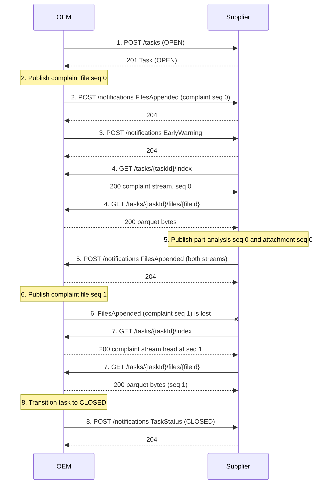
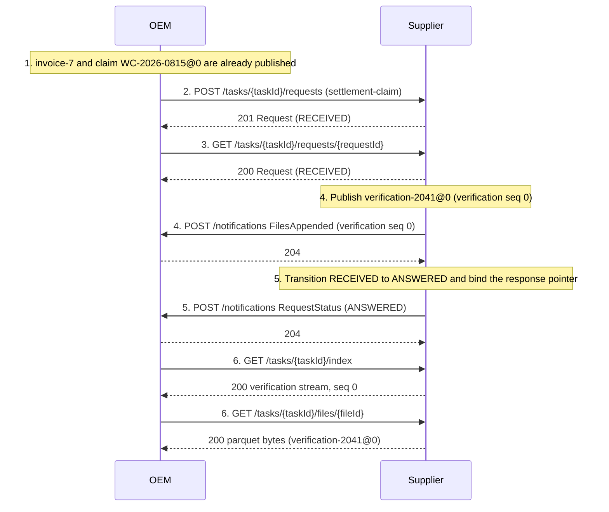
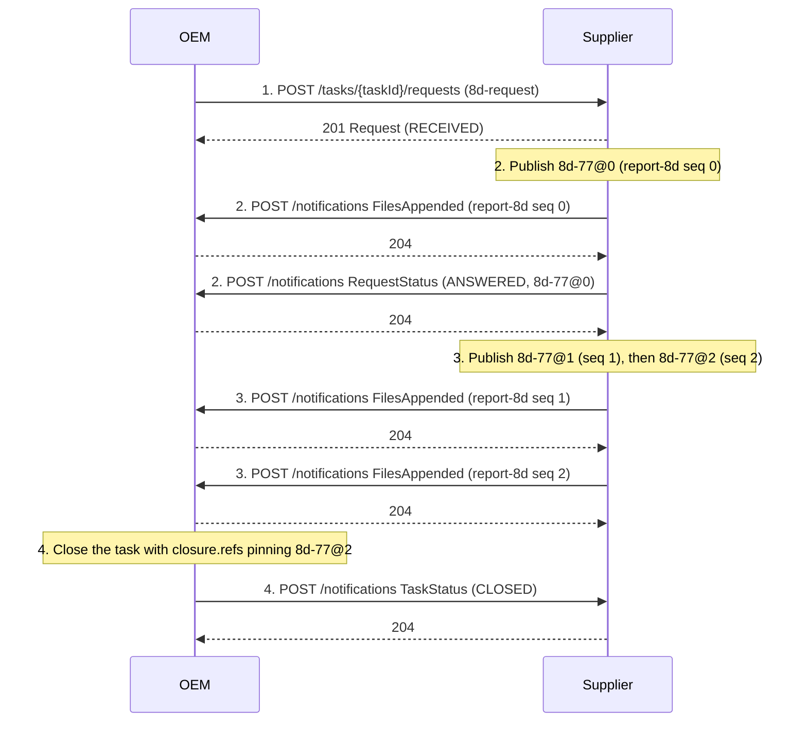
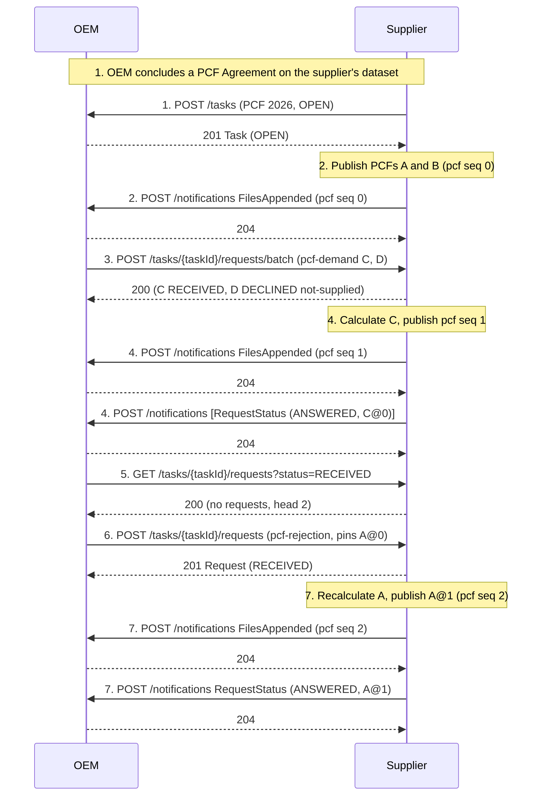

# Structured Task Collaboration Walkthroughs

*This document is non-normative.* It contains examples in the supply chain space used to exercise the
[Structured Task Collaboration](./task-collaboration.md) (STC) specification. Each example shows
concrete endpoint calls, records, and events. The four use cases are a streams-only early warning investigation, a
warranty claim (request/answer), an 8D analysis with an evolving report, and product carbon footprints under
provider-owned tasks with batched demands.

## Conventions

|          | OEM                           | Supplier                        |
| -------- | ----------------------------- | ------------------------------- |
| Identity | `did:web:oem.example.com`     | `did:web:tier1.example.com`     |
| Base URL | `https://oem.example.com/stc` | `https://tier1.example.com/stc` |

The examples use the following stream types and request kinds:

| URI                                                     | Contents                                | Packaging |
| ------------------------------------------------------- | --------------------------------------- | --------- |
| `https://w3id.org/dsaf/quality/v1/complaint`         | Customer complaints (OEM)               | parquet   |
| `https://w3id.org/dsaf/quality/v1/part-analysis`     | Returned-part analyses (supplier)       | parquet   |
| `https://w3id.org/dsaf/warranty/v1/claim`        | Warranty claims (OEM)                   | parquet   |
| `https://w3id.org/dsaf/warranty/v1/verification` | Warranty claim verifications (supplier) | parquet   |
| `https://w3id.org/dsaf/quality/v1/report-8d`          | 8D reports (supplier)                   | parquet   |
| `https://w3id.org/dsaf/quality/v1/attachment`         | Binary attachments (both)               | zip       |
| `https://w3id.org/dsaf/warranty/v1/settlement-claim`  | Warranty claim (request kind)           | n/a       |
| `https://w3id.org/dsaf/quality/v1/8d-request`                | 8D analysis demand (request kind)       | n/a       |
| `https://w3id.org/dsaf/pcf/v1/pcf`                       | Product carbon footprints (supplier)    | parquet   |
| `https://w3id.org/dsaf/pcf/v1/pcf-demand`                | PCF demand (request kind)               | n/a       |
| `https://w3id.org/dsaf/pcf/v1/pcf-rejection`             | PCF rejection (request kind)            | n/a       |

The examples also use the domain event `org.dsaf.quality.EarlyWarning.v1`.

HTTP examples elide authorization headers. Every call runs over the authenticated channel, and the caller's
verified identity is what `author` and event `source` fields must match. Parquet files are shown as tables, with
envelope columns first and `refs` serialized as a JSON column. Record identifiers are UUIDs, abbreviated in the
tables. Prose and the envelope `key` member contain the readable domain names (claim-b, analysis-77, …).

Use Cases 1 and 3 run under the task `430f56d3-7f41-4a7e-9f05-2d6c8b9e4a17` (below: `430f56d3-…`). Use Cases 2
and 4 run under their own tasks, named in their sections.

---

## Use Case 1: Early Warning Investigation (streams only)

The OEM's fleet analytics flag an unusual failure rate in a brake component supplied by the supplier. No
request/response is needed. Both parties publish data, correlate, and close.



### 1. OEM opens the task

```http
POST https://tier1.example.com/stc/tasks
```

```json
{
  "taskId": "430f56d3-7f41-4a7e-9f05-2d6c8b9e4a17",
  "status": "OPEN",
  "createdAt": "2026-10-07T09:00:00Z",
  "title": "Early warning: braking component",
  "description": "Elevated DTC rate in model A vehicles; suspected component lot issue."
}
```

→ `201` with the Task object (`status` `OPEN`). Both sides now hold the binding. The OEM is the Task Owner.
A retry of this POST with the same `taskId` is acknowledged idempotently. A counterparty that will not
participate responds `201` with `status` `DECLINED` and the reasons in the `errors` array.

### 2. OEM publishes claim data (file seq 0)

The OEM exports three complaints as a parquet file. Every record is `ADDED` at revision 0:

| recordId | key | revision | marker | refs | productId | occurredAt | failureCode |
| -------- | --- | -------- | ------ | ---- | --------- | ---------- | ----------- |
| 3f1d9a52-… | claim-a | 0 | ADDED |      | VIN-8842…​ | 2026-09-28 | C1234 |
| b7e3d2c1-… | claim-b | 0 | ADDED |      | VIN-1097…​ | 2026-10-01 | C1234 |
| c9a8b7d6-… | claim-c | 0 | ADDED |      | VIN-5513…​ | 2026-10-03 | C1290 |

It serves the file (cosmetic name `430f56d3-…_oem-example-com_complaint_000000_2026-10-07.parquet`),
appends it to its index, and announces:

```http
POST https://tier1.example.com/stc/notifications
Content-Type: application/cloudevents+json
```

```json
{
  "specversion": "1.0",
  "type": "org.dsaf.stc.FilesAppended.v1",
  "source": "did:web:oem.example.com",
  "id": "7d1c2b3a-4e5f-4a6b-8c7d-9e0f1a2b3c4d",
  "subject": "430f56d3-7f41-4a7e-9f05-2d6c8b9e4a17",
  "time": "2026-10-07T09:12:04Z",
  "datacontenttype": "application/json",
  "data": {
    "taskId": "430f56d3-7f41-4a7e-9f05-2d6c8b9e4a17",
    "streams": [
      {
        "type": "https://w3id.org/dsaf/quality/v1/complaint",
        "files": [
          { "seq": 0, "fileId": "8841a0b1-c2d3-4e5f-8a6b-7c8d9e0f1a2b",
            "createdAt": "2026-10-07T09:12:04Z" }
        ]
      }
    ]
  }
}
```

→ `204`.

### 3. OEM sends the early warning (profile event)

The warning is an informational event referencing the suspect records by pointer. It opens nothing:

```json
{
  "specversion": "1.0",
  "type": "org.dsaf.quality.EarlyWarning.v1",
  "source": "did:web:oem.example.com",
  "id": "2f3e4d5c-6b7a-4891-9c0d-1e2f3a4b5c6d",
  "subject": "430f56d3-7f41-4a7e-9f05-2d6c8b9e4a17",
  "time": "2026-10-07T09:15:00Z",
  "datacontenttype": "application/json",
  "data": {
    "taskId": "430f56d3-7f41-4a7e-9f05-2d6c8b9e4a17",
    "severity": "major",
    "information": "DTC C1234 occurring at 4x baseline in the referenced claims.",
    "records": [
      { "author": "did:web:oem.example.com", "type": "https://w3id.org/dsaf/quality/v1/complaint",
        "record": "3f1d9a52-7c84-4b6e-9d12-aa01bc23de45", "revision": 0, "seq": 0 },
      { "author": "did:web:oem.example.com", "type": "https://w3id.org/dsaf/quality/v1/complaint",
        "record": "b7e3d2c1-4a5f-4b6c-8d9e-0f1a2b3c4d5e", "revision": 0, "seq": 0 }
    ]
  }
}
```

### 4. Supplier syncs and pulls

```http
GET https://oem.example.com/stc/tasks/430f56d3-…/index
```

→ `200`: the complaint stream with file seq 0. The supplier pulls the content:

```http
GET https://oem.example.com/stc/tasks/430f56d3-…/files/8841a0b1-c2d3-4e5f-8a6b-7c8d9e0f1a2b
```

→ `200` (the parquet bytes).

### 5. Supplier contributes analysis and photos

The supplier analyzes the returned part from claim-b and publishes two files, an analysis record and a
photo documenting it:

*Analyses stream, file seq 0:*

| recordId | key | revision | marker | refs | result | finding |
|---|---|---|---|---|---|---|
| a77f0e1d-… | analysis-77 | 0 | ADDED | `[{"author":"did:web:oem.example.com","type":"…/complaint","record":"b7e3d2c1-…","revision":0,"seq":0}]` | defect-confirmed | corrosion at connector pin 4 |

*Attachment stream, file seq 0*, a zip with one record (envelope sidecar and payload):

```
9af0e1d2-c3b4-4a5f-8b6c-7d8e9f0a1b2c_0.json
9af0e1d2-c3b4-4a5f-8b6c-7d8e9f0a1b2c_0.jpg
```

`9af0e1d2-c3b4-4a5f-8b6c-7d8e9f0a1b2c_0.json` (the record's `key` contains the readable name):

```json
{
  "recordId": "9af0e1d2-c3b4-4a5f-8b6c-7d8e9f0a1b2c",
  "key": "photo-9a",
  "revision": 0,
  "marker": "ADDED",
  "mediaType": "image/jpeg",
  "payloadEntry": "9af0e1d2-c3b4-4a5f-8b6c-7d8e9f0a1b2c_0.jpg",
  "refs": [
    { "author": "did:web:tier1.example.com", "type": "https://w3id.org/dsaf/quality/v1/part-analysis",
      "record": "a77f0e1d-2c3b-4a59-8e67-45d2c1b0a9f8", "revision": 0, "seq": 0 }
  ]
}
```

One `FilesAppended` event announces both streams (data = the two new index entries), POSTed to the OEM's
`/notifications`.

### 6. Week 2: the OEM's data changes (file seq 1)

Claim-b was corrected, claim-c turned out to be a misdiagnosis. The next file contains only the changes.
Claim-a does not appear, because absence means unchanged:

| recordId | key | revision | marker | refs | productId | occurredAt | failureCode |
|---|---|---|---|---|---|---|---|
| b7e3d2c1-… | claim-b | 1 | UPDATED | | VIN-1097…​ | 2026-10-01 | C1236 |
| c9a8b7d6-… | claim-c | 1 | DELETED | | | | |

After applying seq 1, the set reads claim-a@0, claim-b@1, and claim-c deleted (its id is never reused). A
`FilesAppended` announces seq 1.

### 7. Recovery: the supplier missed the event

The announcement for seq 1 never arrived. Nothing is lost. On its next sync the supplier pulls the OEM's
index, sees the complaint stream head at seq 1 while it holds only seq 0, and fetches the gap. The same
mechanism covers any number of missed events. Events accelerate delivery. The index is the source of truth.

### 8. OEM closes the task

The countermeasure is confirmed effective. The owner transitions the task and pushes:

```json
{
  "specversion": "1.0",
  "type": "org.dsaf.stc.TaskStatus.v1",
  "source": "did:web:oem.example.com",
  "id": "61f2ac9e-3d44-4b1a-8a0d-7cf2b6a3e951",
  "subject": "430f56d3-7f41-4a7e-9f05-2d6c8b9e4a17",
  "time": "2027-02-01T10:00:00Z",
  "datacontenttype": "application/json",
  "data": {
    "taskId": "430f56d3-7f41-4a7e-9f05-2d6c8b9e4a17",
    "status": "CLOSED",
    "closure": {
        "closedAt": "2027-02-01T10:00:00Z",
        "outcome": "https://w3id.org/dsaf/quality/v1/outcome/resolved",
        "reason": "Root cause confirmed; countermeasure effective from batch 2271.",
        "refs": [
          { "author": "did:web:tier1.example.com", "type": "https://w3id.org/dsaf/quality/v1/part-analysis",
            "record": "a77f0e1d-2c3b-4a59-8e67-45d2c1b0a9f8", "revision": 0 }
      ]
    }
  }
}
```

Streams freeze. The retention clock starts at `closure.closedAt`. A participant that misses this event
discovers `CLOSED` on its next `GET /tasks/430f56d3-…` against the owner.

---

## Use Case 2: Warranty Claim (request and answer)

The OEM demands recompense for the repair behind the field complaint of Use Case 1. Warranty runs under its own
task, the OEM's current warranty task under the Warranty Agreement, because the Warranty Claim Profile keeps claims
in generation tasks owned by the claimant. Pointers never cross tasks, so the claim and its evidence are contributed
under the warranty task. A demand needs receipt, observable state, and explicit refusal, so it is a Task Request,
not a contribution.



### 1. Supporting evidence is already published

The OEM's claim stream contains the claim `WC-2026-0815` @ revision 0 (file seq 0), with the repair date, the
customer part number, and the claimed amount. The repair invoice went into the OEM's attachment stream (file seq 0,
record `invoice-7` @ revision 0). Both were announced like any contribution.

### 2. OEM submits the claim

```http
POST https://tier1.example.com/stc/tasks/5b2e9c71-…/requests
```

```json
{
  "messageId": "b1d5f9e2-3c4b-4f7a-9c3e-2f1e5d6c7b8a",
  "kind": "https://w3id.org/dsaf/warranty/v1/settlement-claim",
  "payload": {
    "claimedAmount": { "value": 418.50, "currency": "EUR" },
    "repairReference": "WC-2026-0815"
  },
  "refs": [
    { "author": "did:web:oem.example.com", "type": "https://w3id.org/dsaf/warranty/v1/claim",
      "record": "6d2f8a14-3b5c-4e7d-9a1f-2c4e6b8d0f13", "revision": 0, "seq": 0 },
    { "author": "did:web:oem.example.com", "type": "https://w3id.org/dsaf/quality/v1/attachment",
      "record": "f7e6d5c4-b3a2-4918-8776-655443322110", "revision": 0, "seq": 0 }
  ],
  "respondBy": "2026-12-01T00:00:00Z"
}
```

→ `201`, `Location: /tasks/5b2e9c71-…/requests/8c1f2d3e-4a5b-4c6d-8e7f-9a0b1c2d3e4f`:

```json
{
  "requestId": "8c1f2d3e-4a5b-4c6d-8e7f-9a0b1c2d3e4f",
  "taskId": "5b2e9c71-8d34-4f2a-9b16-3e7c0a5d1f48",
  "kind": "https://w3id.org/dsaf/warranty/v1/settlement-claim",
  "status": "RECEIVED",
  "changeSeq": 0,
  "payload": { "claimedAmount": { "value": 418.50, "currency": "EUR" }, "repairReference": "WC-2026-0815" },
  "refs": [ "… as submitted …" ],
  "respondBy": "2026-12-01T00:00:00Z"
}
```

The `201` is the receipt. After a network timeout, the OEM retries with the **same** `messageId` and gets
this same request back. The pinned `refs` mean the demand stays bound to the claim at revision 0 even if the claim
record evolves later.

### 3. The wait is observable

```http
GET https://tier1.example.com/stc/tasks/5b2e9c71-…/requests/8c1f2d3e-…
```

→ `200`, `status: RECEIVED`. After `respondBy`, "overdue" is the OEM's local judgment.

### 4. Supplier publishes the answer record before transitioning

The verification goes into the supplier's verification stream, file seq 0:

| recordId   | key               | revision | marker | refs                                                                                                     | acceptedQuota | grounds                                                                       |
| ---------- | ----------------- | -------- | ------ | -------------------------------------------------------------------------------------------------------- | ------------- | ----------------------------------------------------------------------------- |
| 2041fa1b-… | verification-2041 | 0        | ADDED  | `[{"author":"did:web:oem.example.com","type":"…/claim","record":"6d2f8a14-…","revision":0,"seq":0}]` | 0.60          | corrosion consistent with supplied-lot defect; labor rate partially contested |

`FilesAppended` announces it. The spec requires publication no later than the transition, so the pointer bound
next can never dangle.

### 5. Supplier answers the request

The supplier transitions `RECEIVED → ANSWERED`, binding the response pointer, and pushes:

```json
{
  "specversion": "1.0",
  "type": "org.dsaf.stc.RequestStatus.v1",
  "source": "did:web:tier1.example.com",
  "id": "4d5e6f7a-8b9c-4d0e-9f1a-2b3c4d5e6f7a",
  "subject": "8c1f2d3e-4a5b-4c6d-8e7f-9a0b1c2d3e4f",
  "time": "2026-11-20T15:12:00Z",
  "datacontenttype": "application/json",
  "data": {
    "taskId": "5b2e9c71-8d34-4f2a-9b16-3e7c0a5d1f48",
    "requestId": "8c1f2d3e-4a5b-4c6d-8e7f-9a0b1c2d3e4f",
    "status": "ANSWERED",
    "response": {
      "record": { "author": "did:web:tier1.example.com",
                  "type": "https://w3id.org/dsaf/warranty/v1/verification",
                  "record": "2041fa1b-2c3d-4e5f-8a6b-7c8d9e0f1a2b", "revision": 0, "seq": 0 }
    }
  }
}
```

A missed push changes nothing. The next `GET` on the request reports the same `ANSWERED` state and pointer.

### 6. OEM collects the answer

The OEM resolves the pointer. It pulls the supplier's index, locates file seq 0 of the verification stream,
downloads it, and extracts `verification-2041` @ 0. The OEM now has the 60% quota and the `grounds` statement, auditable
against exactly the record revisions both sides saw.

### 7. Variations

- **Immediate decline**: for a claim for a part outside the supplier's scope, the creation response itself is
  `201` with `status: DECLINED` and `errors: [{ "message": "Part 4711-B is not a supplied component" }]`.
  The request exists and reports `DECLINED` with its reasons on every later retrieval.
- **Dispute**: the OEM contests the quota with a **new** request (new `messageId`, kind `settlement-dispute`)
  whose `refs` pin `verification-2041@0`. The original request stays terminal and immutable. The supplier answers
  with a new revision of the same verification record (`verification-2041@1`) or, if it upholds its evaluation,
  with a pointer to the current revision. The current verification of the claim is always the record's current
  revision.

---

## Use Case 3: 8D Analysis (request with an evolving answer)

The OEM formally demands an 8D root cause analysis. The demand is one request. The answer is one record
that matures through revisions.



### 1. OEM submits the 8D demand

```http
POST https://tier1.example.com/stc/tasks/430f56d3-…/requests
```

```json
{
  "messageId": "c2e6a0f3-4d5b-4a8c-9d0e-3f2a1b4c5d6e",
  "kind": "https://w3id.org/dsaf/quality/v1/8d-request",
  "payload": { "problem": "Connector pin corrosion, DTC C1236", "customerPartNumber": "BRK-4711" },
  "refs": [
    { "author": "did:web:oem.example.com", "type": "https://w3id.org/dsaf/quality/v1/complaint",
      "record": "b7e3d2c1-4a5f-4b6c-8d9e-0f1a2b3c4d5e", "revision": 1, "seq": 1 },
    { "author": "did:web:tier1.example.com", "type": "https://w3id.org/dsaf/quality/v1/part-analysis",
      "record": "a77f0e1d-2c3b-4a59-8e67-45d2c1b0a9f8", "revision": 0, "seq": 0 }
  ]
}
```

→ `201`, request `9d2e3f4a-…`, `status: RECEIVED`. (Request `refs` may point at either party's records, here one
of each.)

### 2. Supplier answers with the initial report

The supplier publishes `8d-77` @ revision 0 (D1–D3: team, problem, containment) in its 8D stream, file
seq 0, announces it, then answers the request pinned to that revision:

```json
"response": {
  "record": { "author": "did:web:tier1.example.com", "type": "https://w3id.org/dsaf/quality/v1/report-8d",
              "record": "d8770a1b-2c3d-4e5f-9a6b-7c8d9e0f1a2b", "revision": 0, "seq": 0 }
}
```

The request is now terminal (`ANSWERED`). The obligation is discharged by the initial report. The report
itself continues to evolve.

### 3. The report matures as ordinary revisions

- File seq 1: `8d-77` @ 1, `UPDATED`, root cause identified (D4), with `refs` to the failure-pattern evidence.
- File seq 2: `8d-77` @ 2, `UPDATED`, corrective actions verified (D5–D8).

Each is a complete snapshot, each announced by `FilesAppended`. The request stays pinned to revision 0, the
auditable answer as given. The OEM follows the current report through the unpinned record id (newest-first
lookup, head file first). Supporting lab data and photos go into the attachment stream, and their records
reference `8d-77`.

### 4. Closure cites the final report

When the OEM closes the task, `closure.refs` pins `8d-77` @ revision 2. The closure references its concluding
artifact, and the deletion clock starts for the data contributed under the task.

---

## Use Case 4: Product Carbon Footprints (provider-owned tasks, batched demands)

The OEM needs PCFs for the parts it buys from the supplier. Here the supplier is the Provider and owns the task,
because PCFs are the supplier's records. The OEM starts the relationship by concluding a PCF Agreement, fills gaps
with a batch of demands, and rejects one PCF, which the supplier recalculates.

This use case runs under its own task, the supplier's 2026 PCF task `9c4a7e21-5d3b-4f8a-a6c2-1e7b9d0f3a54`
(below: `9c4a7e21-…`).



### 1. The agreement starts the relationship, and the supplier opens the task

The OEM negotiates the supplier's STC dataset under the offer whose usage policy designates the PCF profile. A
generic STC agreement, for example the one the parties use for quality, would not start a PCF relationship. The
supplier observes the concluded agreement as the provider of the negotiation. It already holds an agreement on the
OEM's dataset, so it opens the first PCF task right away:

```http
POST https://oem.example.com/stc/tasks
```

```json
{
  "taskId": "9c4a7e21-5d3b-4f8a-a6c2-1e7b9d0f3a54",
  "status": "OPEN",
  "createdAt": "2026-11-02T08:00:00Z",
  "title": "PCF 2026",
  "description": "Product carbon footprints for the 2026 reporting period."
}
```

→ `201` with the Task object (`status` `OPEN`). The supplier is the Task Owner. A task the OEM opened itself would
be declined with the reason `https://w3id.org/dsaf/pcf/v1/decline/consumer-owned`.

### 2. Supplier publishes the PCFs it already has (file seq 0)

The supplier publishes the PCFs it has calculated for parts it supplies to the OEM. `footprint` is a JSON column
containing a PACT `ProductFootprint`, abbreviated here:

| recordId | key | revision | marker | version | productId | customerProductId | declaredUnit | footprintModel | footprint |
| -------- | --- | -------- | ------ | ------- | --------- | ----------------- | ------------ | -------------- | --------- |
| d1a4c7e2-… | pcf-A | 0 | ADDED | 0 | HSG-100 | CP-900 | 1 piece | `…/footprint-model/pact/3` | `{"id":"5e1f…","specVersion":"3.0.0","status":"Active",…}` |
| e2b5d8f3-… | pcf-B | 0 | ADDED | 0 | BRK-210 | CP-912 | 1 kilogram | `…/footprint-model/pact/3` | `{"id":"6f2a…","specVersion":"3.0.0","status":"Active",…}` |

Both records also contain `referencePeriod` (2026-01-01 to 2026-12-31) and `validityPeriod`, matching the
footprint's `pcf.referencePeriodStart`, `pcf.referencePeriodEnd`, `validityPeriodStart`, and `validityPeriodEnd`. The
supplier announces the file with `FilesAppended`, as in Use Case 1.

### 3. OEM demands the missing PCFs in one batch

The OEM reconciles the PCFs against its bill of materials and finds two parts without one. It submits both demands in
one call, identifying the parts by its own part numbers:

```http
POST https://tier1.example.com/stc/tasks/9c4a7e21-…/requests/batch
```

```json
{
  "requests": [
    {
      "messageId": "1a2b3c4d-5e6f-4a7b-8c9d-0e1f2a3b4c5d",
      "kind": "https://w3id.org/dsaf/pcf/v1/pcf-demand",
      "payload": { "customerProductId": "CP-930" },
      "respondBy": "2026-12-15T00:00:00Z"
    },
    {
      "messageId": "6e7f8a9b-0c1d-4e2f-9a3b-4c5d6e7f8a9b",
      "kind": "https://w3id.org/dsaf/pcf/v1/pcf-demand",
      "payload": { "customerProductId": "CP-944" },
      "respondBy": "2026-12-15T00:00:00Z"
    }
  ]
}
```

→ `200`. The supplier recognizes at once that it does not supply CP-944 to the OEM and declines that demand in the
response. The other demand waits for a calculation:

```json
{
  "requests": [
    {
      "requestId": "7b8c9d0e-1f2a-4b3c-8d4e-5f6a7b8c9d0e",
      "taskId": "9c4a7e21-5d3b-4f8a-a6c2-1e7b9d0f3a54",
      "kind": "https://w3id.org/dsaf/pcf/v1/pcf-demand",
      "status": "RECEIVED",
      "changeSeq": 0,
      "payload": { "customerProductId": "CP-930" },
      "respondBy": "2026-12-15T00:00:00Z"
    },
    {
      "requestId": "8c9d0e1f-2a3b-4c4d-9e5f-6a7b8c9d0e1f",
      "taskId": "9c4a7e21-5d3b-4f8a-a6c2-1e7b9d0f3a54",
      "kind": "https://w3id.org/dsaf/pcf/v1/pcf-demand",
      "status": "DECLINED",
      "changeSeq": 1,
      "payload": { "customerProductId": "CP-944" },
      "respondBy": "2026-12-15T00:00:00Z",
      "errors": [
        { "message": "CP-944 is not supplied to this customer",
          "specifier": "https://w3id.org/dsaf/pcf/v1/decline/not-supplied" }
      ]
    }
  ]
}
```

Each demand has its own `requestId`, state, and outcome. A batch of thousands of demands works the same way. A
retry of the whole batch after a timeout returns the same requests, because each element is idempotent on its
`messageId`.

### 4. Supplier answers with a new record and a batch of status events

The supplier calculates the PCF for CP-930 and publishes it as file seq 1: `pcf-C` @ revision 0, `ADDED`, `version`
0, `productId` `HSG-130`, `customerProductId` `CP-930`. No live PCF for the part existed in any open task, so the
record goes to the task the demand was submitted under. It announces the file and then sends the status events as a
DCM batch, a JSON array of events, here with one element:

```json
[
  {
    "specversion": "1.0",
    "type": "org.dsaf.stc.RequestStatus.v1",
    "source": "did:web:tier1.example.com",
    "id": "2c3d4e5f-6a7b-4c8d-9e0f-1a2b3c4d5e6f",
    "subject": "7b8c9d0e-1f2a-4b3c-8d4e-5f6a7b8c9d0e",
    "time": "2026-11-20T10:00:00Z",
    "datacontenttype": "application/json",
    "data": {
      "taskId": "9c4a7e21-5d3b-4f8a-a6c2-1e7b9d0f3a54",
      "requestId": "7b8c9d0e-1f2a-4b3c-8d4e-5f6a7b8c9d0e",
      "status": "ANSWERED",
      "response": {
        "record": { "author": "did:web:tier1.example.com", "type": "https://w3id.org/dsaf/pcf/v1/pcf",
                    "record": "f3c6e9a4-7b1d-4c2e-8f5a-9b0c1d2e3f4a", "revision": 0, "seq": 1 }
      }
    }
  }
]
```

### 5. OEM checks that nothing is pending

The OEM does not need to track each event. It asks the supplier's request listing for demands still open:

```http
GET https://tier1.example.com/stc/tasks/9c4a7e21-…/requests?status=RECEIVED
```

→ `200`:

```json
{ "taskId": "9c4a7e21-5d3b-4f8a-a6c2-1e7b9d0f3a54", "head": 2, "requests": [] }
```

`head` is 2 because the responder recorded three changes: the creation of each demand (0 and 1) and the answer to
the first (2). An empty page means every demand is terminal. A requester that missed events pages through the listing
with `fromChangeSeq` instead of polling each request.

### 6. OEM rejects one PCF

The OEM's review finds that the PCF for HSG-100 uses an outdated emission factor for aluminium. It rejects the
revision it evaluated:

```http
POST https://tier1.example.com/stc/tasks/9c4a7e21-…/requests
```

```json
{
  "messageId": "3d4e5f6a-7b8c-4d9e-8f0a-1b2c3d4e5f6a",
  "kind": "https://w3id.org/dsaf/pcf/v1/pcf-rejection",
  "payload": {
    "findings": [
      { "category": "data-quality", "message": "Aluminium emission factor is from 2019; the agreement requires 2024 or later." }
    ]
  },
  "refs": [
    { "author": "did:web:tier1.example.com", "type": "https://w3id.org/dsaf/pcf/v1/pcf",
      "record": "d1a4c7e2-8b3f-4a5c-9d6e-0f1a2b3c4d5e", "revision": 0, "seq": 0 }
  ],
  "respondBy": "2026-12-20T00:00:00Z"
}
```

→ `201` with the Request object (`RECEIVED`). Absence of a rejection would have meant the PCF stands. There is no
acceptance step.

### 7. Supplier recalculates (Recalculated)

The supplier recalculates with the current factor and publishes file seq 2: `pcf-A` @ revision 1, `UPDATED`,
`version` 1. The PACT footprint in the new revision has a new `id`, and its `precedingPfIds` contains the `id` of the
footprint in revision 0, as the PACT binding of the profile requires. The supplier answers the rejection with a
pointer pinned to revision 1. The rejection stays pinned to revision 0, so both the contested footprint and the
correction remain on record.

### 8. Variations

- **Yearly rollover**: at the start of 2027 the supplier opens a new PCF task, which becomes the Current Task. New
  PCFs for the 2027 reporting period go there and supersede their 2026 predecessors, which end with a `SUPERSEDED`
  revision in the 2026 task. The 2026 task closes once nothing in it is live.
- **Replaced**: had the finding concerned the declared unit, a member of the PCF Key, the supplier would withdraw
  `pcf-A` and publish a new record naming it in `replaces`.
- **Update demand**: for a PCF it holds but wants refreshed, the OEM submits a `pcf-update-demand` pinning the
  revision it has.
- **Agreement ends**: the supplier declines open requests with `terminated` and closes every open PCF task with the
  outcome `terminated`.

---

## The One Recovery Rule

Every walkthrough step that pushed an event recovers the same way. If the event is lost, the fact it
announced is recoverable by pull:

| Lost event | Recovered by |
|---|---|
| `FilesAppended` | `GET /tasks/{taskId}/index` (the gapless `seq` exposes the missing files) |
| `RequestStatus` | `GET /tasks/{taskId}/requests/{requestId}`, or `GET /tasks/{taskId}/requests?fromChangeSeq=n` for many requests |
| `TaskStatus` | `GET /tasks/{taskId}` against the owner |
| profile events (early warning) | re-sent by their author, or moot, because they reference records the index already lists |

Events cost latency when lost, never consistency.
