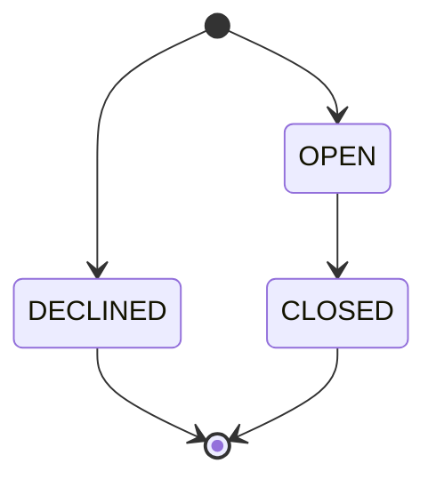
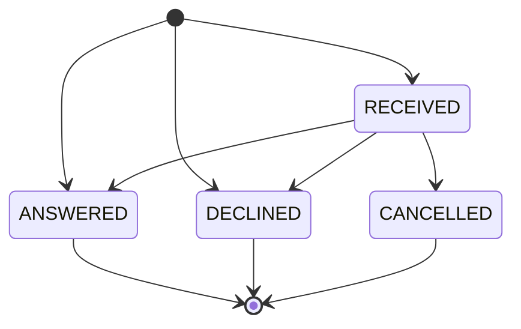
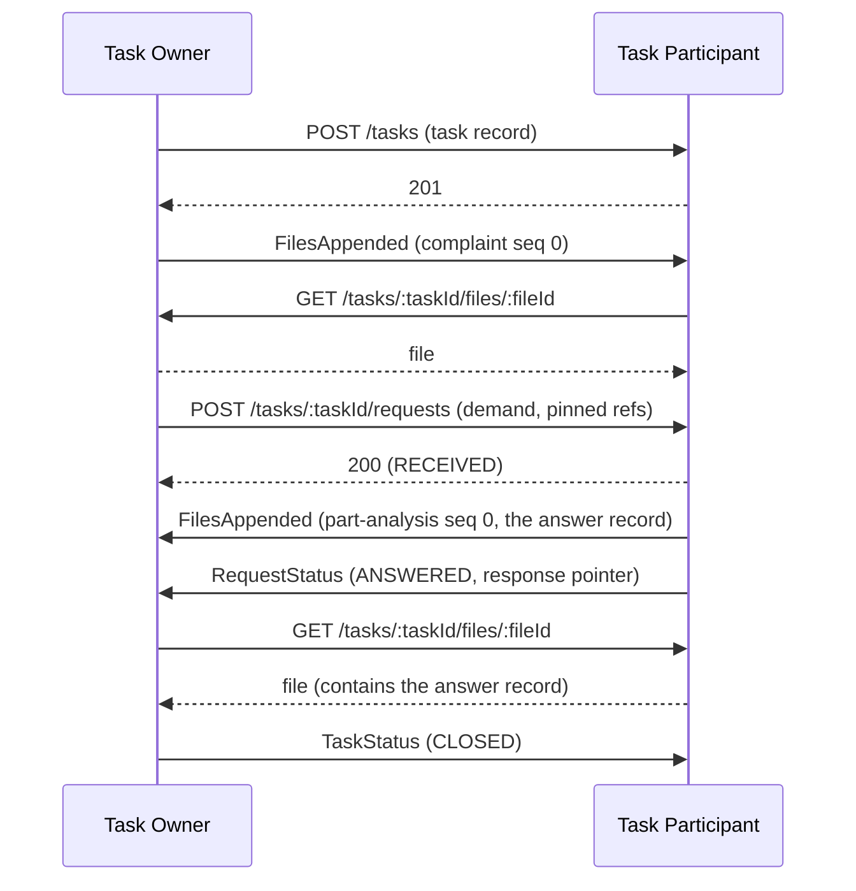

# Structured Task Collaboration

Structured Task Collaboration (STC) defines an interoperable protocol for bilateral, long-running data collaboration
between dataspace participants. It specifies the task context under which collaboration takes place, the stream
model by which both parties contribute versioned records, the index and events that make contributions observable and
recoverable, and the request/response interaction for demands that require an answer.

STC is a [=Composing Specification=] of [Dataspace Core Messaging](../dcm/core-messaging.md) [[dcm]]. All events
defined in this specification MUST conform to that specification.

STC is domain-agnostic. The record schemas, request kinds, and packaging formats used in a deployment are defined by
[=Use Case Profiles=] (see [Use Case Profiles](#use-case-profiles)). A [=Dataspace Profile=] MAY adapt them to the
rules of a dataspace (see [Dataspace Profiles](#dataspace-profiles)). Quality management, warranty settlement, and
root cause analysis are examples of use case profiles.

## Terminology

The following terms are used to describe concepts in this specification. The terms [=Event=], [=Producer=],
[=Consumer=], and [=Participant=] are defined in [[dcm]].

- <dfn>Task</dfn>: A bilateral collaboration context between two [=Participants=], under which all data contributions
  and requests of one collaboration are correlated.
- <dfn>Task Owner</dfn>: The [=Participant=] that opened a [=Task=]. The owner transitions the task after creation.
- <dfn>Task Participant</dfn>: The counterparty of the [=Task Owner=] in a [=Task=].
- <dfn>Stream</dfn>: An append-only sequence of [=Files=] contributed by one [=Participant=] under a [=Task=],
  containing [=Records=] of a single type. It is identified by a `stream` identifier assigned by its publisher.
- <dfn>File</dfn>: An immutable package of [=Record Entries=], identified by its position in a [=Stream=].
- <dfn>Record</dfn>: A versioned data artifact contributed under a [=Task=]. A record is the unit of reference.
- <dfn>Record Entry</dfn>: The occurrence of one [=Record=] revision in a [=File=], containing the record's state at
  that revision and its change marker.
- <dfn>Revision</dfn>: The monotonically increasing version counter of a [=Record=] under its stable
  identifier.
- <dfn>Pointer</dfn>: A reference to a [=Record=] by its [=Stream=] and `recordId`.
- <dfn>Task Index</dfn>: The authoritative, append-only listing of the [=Files=] a [=Participant=] has contributed to
  a [=Task=], served by that participant.
- <dfn>Task Request</dfn>: A resource under a [=Task=], owned by the responder, that represents a request by the
  counterparty to perform an action, with observable state.
- <dfn>Use Case Profile</dfn>: A specification built on STC that defines the record schemas, request kinds,
  packaging formats, and additional domain event types of a domain.
- <dfn>Dataspace Profile</dfn>: A specification that applies one or more [=Use Case Profiles=] to the rules of a
  dataspace.

## Conformance

The keywords MAY, MUST, MUST NOT, OPTIONAL, RECOMMENDED, REQUIRED, SHOULD, and SHOULD NOT in this document are to be
interpreted as described in BCP 14 [[rfc2119]] [[rfc8174]] when, and only when, they appear in all capitals, as shown
here.

The protocol is symmetric. Both parties to a [=Task=] act in both directions. A conforming [=Participant=] MUST
implement the [Task Collaboration API](#task-collaboration-api) in its entirety and MUST comply with the state
machines, event definitions, and data model defined in this specification.

## Base Concepts

### Task

A [=Task=] represents one collaboration. Each [=Stream=], [=Record=], [=Task Request=], and [=Event=] belongs to
exactly one [=Task=] and is correlated by that task's `taskId`.

A [=Task=] is bilateral. A collaboration among more than two parties is modeled as multiple tasks. Each task is
between two parties and has its own [=Task Owner=].

[=Pointers=] never cross tasks (see [Pointers](#pointers)). A record references only records in its own task. A
relationship between tasks, such as a successor task or a chain of tasks across dataspace participants, is contained in
data or maintained privately by the applications. For example, the `closure` `reason` can name the successor task's
`taskId`.

#### Identity and Creation

A [=Task=] is identified by a `taskId` assigned by the [=Task Owner=] when the task is opened. The `taskId` MUST be a
UUID [[rfc9562]].

Either party can open a [=Task=] by invoking the counterparty's
[Task Creation](#task-creation) endpoint. The party that opens the task is the [=Task Owner=]. A counterparty that
does not want to participate declines the task at creation (see [Task State Machine](#task-state-machine)). A
counterparty that accepted the task but will not act on a particular demand declines that [=Task Request=]. Only the
[=Task Owner=] can close the task.

#### Task State Machine

Implementation MUST support the following [=Task=] states:



| State    | Set by | Terminal | Description                                                                                 |
|----------|-------|----------|-------------------------------------------------------------------------------------------|
| `OPEN`   | [=Task Owner=] | No  | The task is active. Both parties contribute [=Files=] and submit [=Task Requests=]. |
| `DECLINED` | [=Task Participant=] | Yes | The receiving party declined the task at creation. The reasons are contained in the `errors` array. Terminal. |
| `CLOSED` | [=Task Owner=] | Yes | The task is concluded. Terminal.                                                    |

A task is declined in the creation response (see [Task Creation](#task-creation)). After creation, only the [=Task Owner=] transitions the task. Closure is announced by a
[`TaskStatus` event](#task-status-event) and is observable at any time via [Task Retrieval](#task-retrieval).

The decline is recorded on the task. When the task is `DECLINED`, the [Task object](#task-object) MUST contain a
non-empty `errors` array of [error objects](#error-object) with the reasons for the decline. A [=Use Case Profile=] MAY
define decline reason URIs for the error `specifier`.

A task in a terminal state is unmodifiable. A [=Participant=] MUST NOT append [=Files=] to the task's [=Streams=] and MUST
NOT submit [=Task Requests=] under it. A request submitted under a terminal task MUST be rejected with
`HTTP 409 Conflict`. A terminal task MUST NOT be reopened or transitioned further. A new attempt at the collaboration
is a new task with a new `taskId`.

The [=Task Owner=] SHOULD NOT close a task while a [=Task Request=]
under it is not terminal, because the request can no longer be answered after closure. [=Task Requests=] that are
nevertheless not terminal at closure time SHOULD be concluded. How they are concluded is defined by
[=Use Case Profiles=]. The [=Task Owner=] concludes a request it submitted itself by cancelling it (see
[Request Cancellation](#request-cancellation)).

Closure is unilateral. The rule above binds the [=Task Owner=] only. A [=Task Participant=] MUST accept a closure
regardless of [=Task Requests=] still open under the task. The participant has no veto, and a closure that overrides
ongoing requests is valid. Enforcement of the rule is local to the [=Task Owner=] and out of scope of this
specification (for example,
an implementation's management layer may refuse to close a task with non-terminal requests unless explicitly
overridden).

Closure is recorded on the task. When the task is `CLOSED`, the [Task object](#task-object) MUST contain a `closure`
member. The member records the time of closure and, optionally, an `outcome` defined by the [=Use Case Profile=], a
human-readable `reason`, and [=Pointers=] to the records that conclude the collaboration (for example, a final report).
Outcomes do not add states to the task. Every closure ends in the single `CLOSED` state, and the `outcome` value on the
`closure` record distinguishes how it concluded (for example, resolved, aborted, or superseded). The outcome values are
defined by [=Use Case Profiles=].

Task metadata (`title`, `description`) is immutable. It is set at creation and never updated.

#### Task Retention

Retention is governed by the [[dsp]] agreement or the [=Dataspace Profile=], not by this specification. The retention
period starts when the task reaches a terminal state. For a `CLOSED` task this instant is `closure.closedAt`. For a
`DECLINED` task it is `createdAt`, because the decline is synchronous with creation. After the retention period, the
endpoints defined by this specification MAY respond with `HTTP 404 Not Found` for the task. Retention continues
after the governing agreement ends (see [Agreement Lifecycle](#agreement-lifecycle)).

### Streams

A [=Stream=] is the unit of contribution and delivery ordering. It is identified by a `stream` identifier, a UUID
[[rfc9562]] that the contributing [=Participant=] assigns when it creates the stream. The identifier is unique under
the [=Task=] and MUST NOT change for the life of the stream. A stream has a `type`, a URI identifying the schema and
major version of the [=Records=] it contains.

A [=Stream=] has no state. Its publisher creates it and lists it in its [=Task Index=] from that point on, with no
files until the first is published. A receiver learns a stream's identifier and `type` from the index, the
[Task Summary](#task-summary), or a [`FilesAppended` event](#files-appended-event).

The following rules apply:

1. A [=Record=] belongs to exactly one [=Stream=]. All revisions of a record appear in the same stream.
2. A schema change that is not backward compatible is a new `type` and therefore a new stream. A [=Participant=] MAY
   contribute to the old and new stream concurrently during a migration.
3. A [=Participant=] MUST NOT operate two streams with the same `type` under one task unless a [=Use Case Profile=]
   permits it for that `type`.
4. Consumption is selective per stream. A [=Participant=] MAY follow or ignore any stream of its counterparty. A
   stream whose `type` the consumer does not implement is not an error. The consumer ignores streams it does not
   follow, whether encountered in the [=Task Index=] or in a [`FilesAppended` event](#files-appended-event).

### Files

A [=File=] is an immutable package of [=Record Entries=], assigned a sequence number `seq` by its publisher:

- `seq` MUST start at `0` for the first file of a [=Stream=] and MUST increase by exactly `1` for each subsequent
  file. The sequence has no gaps, so a missing file is detectable.
- A published file MUST NOT be modified or replaced. A correction is a new file containing new [=Record Entries=].
- Each file has a `fileId` (the retrieval handle) and a `createdAt` timestamp, published in
  the [=Task Index=]. The index entry SHOULD also contain the file's `size` in bytes and its `entryCount`, the
  number of [=Record Entries=] it contains, so that a consumer can bound a download before it starts and detect a
  truncated transfer. Transport integrity derives from the secured channel ([[dcm]]). Implementations MAY keep
  their own content digests privately.

A file is a delta of the record set. It contains entries only for records that changed. The absence of a record from a
file means the record is unchanged.

#### Packaging

The serialization of a [=File=] is declared by its [=Stream=]'s type. The [=Use Case Profile=] assigns each stream
type its exact file format, identified by a media type, and the envelope mapping the format follows. A
[=Dataspace Profile=] MAY replace the file format of a stream type (see [Dataspace Profiles](#dataspace-profiles)).
Where one applies, files follow it. Both parties therefore know a file's format and its `Content-Type` from the
stream type and the applicable dataspace profile. Nothing is negotiated or inferred per file.
Two envelope mappings are defined:

**Tabular packaging** serializes [=Record Entries=] as rows (for example, in a columnar format such as Apache
Parquet). The [envelope fields](#record-entry-envelope) MUST be present as columns named exactly `recordId`,
`revision`, `marker`, and (where used) `refs` and `key`. The record payload occupies the remaining columns. The file
format a [=Use Case Profile=] or [=Dataspace Profile=] assigns to a stream type MUST fix the name, type, nullability,
and nesting of every payload column, so that every producer of the stream type writes the same columns (for example,
as a Parquet message type). Every top-level payload column MUST be nullable (in Parquet, `optional`), because a
`DELETED` entry has no payload. Whether a member is required in a record is a rule of the record schema, not of the
column.

The envelope columns MUST have the following types: `recordId` a string containing the UUID in canonical lowercase
form, `revision` a 64-bit signed integer, `marker` a string, and `key` a string. In Parquet, `revision` is an `int64`
column, and the string columns are `binary` columns annotated with the `STRING` logical type.

The `refs` column, when present, MUST contain the entry's [=Pointers=] serialized as a JSON array (in Parquet, a
string or binary column, RECOMMENDED to be annotated with the JSON logical type). Payload fields SHOULD be
represented as individually typed columns, natively nested where the format supports it, rather than as a single
serialized-JSON column. A use case profile or a dataspace profile MAY designate specific irregular payload fields
as JSON columns.

**Schema evolution within a stream.** The stream `type` pins the record schema's major version. Files later in a
stream MAY reflect a backward-compatible minor revision of that schema. Under tabular packaging, this means
additional optional columns. A consumer MUST ignore columns it does not recognize and MUST tolerate the absence of optional
columns. Any change that is not backward compatible creates a new stream (see [Streams](#streams)).

**Archive packaging** serializes [=Record Entries=] as entries of an archive (for example, ZIP), for records whose
payloads are binary content. Every artifact is addressed by its exact entry name:

- The envelope of the record revision `<recordId>` / `<revision>` MUST be stored as the entry
  `<recordId>_<revision>.json`, conforming to the [Record Entry envelope](#record-entry-envelope). A consumer
  constructs this name from the record identity.
- The payload MUST be stored as the entry named by the envelope's `payloadEntry` member. The writer chooses the
  entry name, which MUST be unique within the archive. A `DELETED` entry has no payload entry and no `payloadEntry`
  member. The payload's media type is declared by the envelope's `mediaType`, never derived from the entry name.

File names outside a package are not significant. A [=File=] is identified by (stream, `seq`) and retrieved by
`fileId`. Implementations MUST NOT derive protocol information from file names.

### Records

A [=Record=] is a versioned data artifact. A [=Record Entry=] is the occurrence of one record revision in a
[=File=]. An `ADDED` or `UPDATED` entry contains a complete snapshot of the record at that revision, together with
its change marker and envelope members. A `DELETED` entry contains only the record identity, the revision, and the
marker. There is exactly one entry per (`recordId`, `revision`), and each entry resides in exactly one [=File=].

A record never appears on the wire as itself. It exists as its entries. Replaying a record's entries in revision
order yields the record's history, and the entry with the highest revision is its current state. [=Files=] contain
record entries. [=Pointers=] reference records, not files or record entries.

#### Identity and Versioning

A record is identified by a `recordId` assigned by its publisher, unique within its [=Stream=] and stable for the life of
the record. The `recordId` MUST be a UUID [[rfc9562]] in canonical lowercase form.

The publisher's domain identifier for the record (for example, a backend claim number) MAY be contained in the envelope's
`key` member (see [Record Entry Envelope](#record-entry-envelope)). The `key` is informational free text. It is
stable across revisions and SHOULD be unique within the stream. It is never used for reference. [=Pointers=] use the
`recordId`. Publishing the `key` is the publisher's choice, because an internal key can be sensitive. A published `key`
also makes the publisher's domain-key mapping recoverable from its own streams.

A record is versioned by a `revision` counter. The counter is an integer that starts at `0` and increments by `1`
for every change, including deletion. Every `ADDED` or `UPDATED` revision is a complete snapshot of the record.
Revisions are never deltas or patches. A deletion consumes a revision but contains no payload (see
[Record Entry Markers](#record-entry-markers)).

#### Record Entry Markers

Each [=Record Entry=] contains a `marker` declaring the kind of change it represents:

| Marker    | Constraint                                                                                                   |
|-----------|--------------------------------------------------------------------------------------------------------------|
| `ADDED`   | MUST appear only at `revision` `0`, the record's first entry.                                                |
| `UPDATED` | A subsequent complete snapshot. MUST NOT appear at `revision` `0`.                                            |
| `DELETED` | Retracts the record. Consumes a revision, contains no payload, and is terminal. No entry for the `recordId` is valid after it. The identifier MUST NOT be reused. |

Within a stream, the entries of one `recordId` MUST appear in revision order across the file sequence, at most one
entry per record per file. A receiver detecting a violation (an `ADDED` for an existing record, an `UPDATED` or
`DELETED` for an unknown record, a revision gap, or an entry after `DELETED`) MUST treat the stream as erroneous and
SHOULD resynchronize from the publisher's [=Task Index=]. How the error is surfaced between the parties is defined by
[=Dataspace Profiles=].

Because every entry is self-contained, two consumption strategies are equivalent. This observation is
non-normative. Replaying a stream's files in sequence order reconstructs the full record set. Searching the files
newest-first finds the current revision of an individual record without replay.

#### Record Entry Envelope

Every [=Record Entry=] contains the following envelope, in the slot its [packaging](#packaging) defines:

|              |                                                                                                              |
|--------------|----------------------------------------------------------------------------------------------------------------|
| **Schema**   | [JSON Schema](./schemas/record.entry.schema.json)                                                             |
| **Required** | - `recordId`: The record's identifier (see [Identity and Versioning](#identity-and-versioning)).              |
|              | - `revision`: The revision this entry represents.                                                               |
|              | - `marker`: One of `ADDED`, `UPDATED`, `DELETED`.                                                             |
| **Optional** | - `refs`: An array of [=Pointers=] (see [Pointers](#pointers)). MUST be absent when `marker` is `DELETED`.    |
|              | - `mediaType`: The payload's media type [[rfc2046]]. REQUIRED under archive packaging when a payload is present. Absent otherwise. |
|              | - `payloadEntry`: The exact archive entry name of the payload (see [Packaging](#packaging)). REQUIRED under archive packaging when a payload is present. Absent otherwise. |
|              | - `key`: The publisher's domain identifier for the record (see [Identity and Versioning](#identity-and-versioning)). Informational. Never used for reference. |

### Pointers

A [=Pointer=] references a [=Record=] from another record, a [=Task Request=], or an [=Event=]. Pointers are the only
cross-reference mechanism of this specification. Nothing references a [=File=] or a position within one.

Pointers are task-scoped. A pointer MUST reference a record contributed under the same [=Task=] as the construct
containing it. Resolution is against the [=Task Index=] of the party whose index lists the pointer's `stream`. A
pointer whose `stream` is listed in neither party's index is invalid. A record needed under another task, such as
evidence for a demand raised in a different collaboration, is contributed again under that task.

|              |                                                                                                              |
|--------------|----------------------------------------------------------------------------------------------------------------|
| **Schema**   | [JSON Schema](./schemas/pointer.schema.json)                                                                  |
| **Required** | - `stream`: The identifier of the [=Stream=] containing the referenced record (see [Streams](#streams)).      |
|              | - `record`: The `recordId` of the referenced record.                                                          |
| **Optional** | - `revision`: Pins the reference to a specific record revision. If omitted, the reference designates the record's current revision at resolution time. |
|              | - `seq`: The `seq` of the [=File=] containing the pinned revision. MUST NOT be present without `revision`.        |

A pinned (`record`, `revision`) pair resides in exactly one immutable [=File=], so `seq` is a stable fact and MAY be
recorded as a resolution shortcut. The `seq` is advisory. If the entry is not found at `seq`, the resolver falls back
to locating the revision via the [=Task Index=]. Pointers to records the resolving party has not yet retrieved are
valid. Resolution retrieves on demand.

A pointer MAY reference a `DELETED` record (at a pinned revision preceding the deletion, or unpinned). An unpinned
pointer whose record has been deleted resolves to the deletion fact, not to content.

### Task Index

The [=Task Index=] is the source of truth for a [=Participant=]'s contributions to a [=Task=]. Each party serves
exactly its own contributions. The full file listing of a task is the union of the two parties' indexes. Neither
party republishes the other's contributions.

The index is append-only. Entries are added as files are published and MUST NOT be removed or altered while the task
is retained. Together with the gapless `seq`, the index is the recovery mechanism of the protocol. A party that
missed any number of events reconstructs completeness by retrieving the counterparty's index and fetching the files
absent from its own holdings.

Events are hints, never the system of record. No correctness property of this protocol depends on the delivery of
an event. Every event is recoverable from the [=Task Index=], the [request listing](#request-listing), and the
resources they list. The [Task Summary](#task-summary) endpoint reports the positions of all of them in one
conditional request, so that a party can detect missed events for many tasks at low cost.

### Task Requests

A [=Task Request=] is opened by one party to request the other to perform an action, for example to evaluate a
settlement claim or to perform an 8D analysis. The action is identified by the request's `kind`, a URI defined by a
[=Use Case Profile=]. The request contains a payload conforming to the kind and optional [=Pointers=] to the records it
concerns. The responder owns the request and serves its state at any time (see
[Request State Machine](#request-state-machine)). The responder answers the request with the action's result,
contributed as a [=Record=], or declines it with reasons. The requester MAY cancel a request it no longer needs
before the responder answers or declines it (see [Request Cancellation](#request-cancellation)).

#### Identity and Correlation

A [=Task Request=] is identified by a `requestId` assigned by the receiving party (the responder) when the request is
created, and is scoped to its [=Task=]. The `requestId` is the correlation handle for the interaction.

A request is created by the requesting party, the requester, via [Request Creation](#request-creation), one or
more at a time. Once a request is created, its
existence and state are observable via [Request Retrieval](#request-retrieval) and
[Request Listing](#request-listing).

#### Request State Machine

Implementations MUST support the following [=Task Request=] states:



| State      | Owner     | Terminal | Description                                                                                                |
| ---------- | --------- | -------- | ---------------------------------------------------------------------------------------------------------- |
| `RECEIVED` | Responder | No       | The request is created and its outcome is pending.                                           |
| `ANSWERED` | Responder | Yes      | The response is available. The request's `response` references it (see [Request Object](#request-object)). |
| `DECLINED` | Responder | Yes      | The responder will not answer the request. The reasons are contained in the `errors` array.                  |
| `CANCELLED` | Requester | Yes     | The requester withdrew the request before it was answered or declined (see [Request Cancellation](#request-cancellation)). |

A responder that can answer immediately MAY report `ANSWERED` directly in the creation response. The states
represent business-level outcomes only. Technical and transport failures are not modeled as request states.

`CANCELLED` is the only state set by the requester, and it is reachable only from `RECEIVED`. The cancellation is
unilateral. The responder does not decide whether to accept it. From the moment the responder records the
cancellation, it MUST NOT answer or decline the request. Records the responder has published, or publishes later,
remain ordinary contributions to its streams but are not the request's response. The consequences of a
cancellation, such as costs the responder has already incurred, are defined by [=Use Case Profiles=] or the governing
[[dsp]] agreement.

A terminal request MUST NOT be reopened or transitioned further. A renewed demand, for example, a resubmitted claim,
is a new [=Task Request=].

The response content is a [=Record=]. The responder contributes it to a stream. The request's `response` references
it by [=Pointer=]. The responder MUST publish the response record, listed in its [=Task Index=], no later than it
reports `ANSWERED`, so the response pointer always resolves. The request's `response` pointer MUST be revision-pinned to the revision that answered it (see
[Request Object](#request-object)), so later revisions of the response record never alter the answer as given.
Whether the response record may be revised after the request is answered is defined by the [=Use Case Profile=]. A use
case profile MAY declare a response record type final once cited by a response. 

A request MAY contain a `respondBy` deadline. The deadline is informational and does not transition the request.
Whether a request is overdue is a decision the requester makes locally. Deadline consequences are defined by
[=Use Case Profiles=] or the governing [[dsp]] agreement.

## Identity

A [=Participant=] is identified by its verified identity. This is the identity authenticated on the transport
channel and contained in an [=Event=]'s `source` attribute (see [[dcm]]), for example, a Decentralized Identifier
(DID) [[did-core]]. Where a dataspace assigns distinct participant identifiers, the `dataspaceidentifier` extension
attribute of [[dcm]] applies, and [=Use Case Profiles=] MAY require it.

## Protocol Events

All events defined by this specification MUST conform to [[dcm]], including its HTTPS binding and batch rules. The
following event types are defined:

| Event Type                      | Direction             | Purpose                                                  |
| ------------------------------- | --------------------- | -------------------------------------------------------- |
| `org.dsaf.stc.TaskStatus.v1`    | Owner → Participant   | Communicates the current [=Task=] state                  |
| `org.dsaf.stc.FilesAppended.v1` | Publisher → Counterparty | Announces [=Files=] appended to its [=Streams=] |
| `org.dsaf.stc.RequestStatus.v1` | Responder → Requester | Communicates the terminal state of a [=Task Request=]    |

[=Use Case Profiles=] MAY define additional event types (for example, a domain alert). A use case profile event that
concerns records MUST reference them as [=Pointers=] and MUST be scoped to a task by containing the `taskId` in its data
and as its `subject`.

An event MUST be rejected with `HTTP 400 Bad Request` when its `source` is not the party its type defines as the
sender. The sender of each core event is defined in its section below, and a use case profile event defines its
sender the same way. The rule defines receiver behavior only. A role-mismatched event cannot corrupt state, because a
party never updates state it owns from an inbound event.

### Task Status Event

A `TaskStatus` event reports the current [=Task=] state. The [=Task Owner=] MUST push it when the task is closed and
MAY push an `OPEN` form to re-announce an open task. The event is informational. The authoritative state is served
by [Task Retrieval](#task-retrieval). `DECLINED` is never pushed. It is reported synchronously in the creation response.

The `subject` attribute of the event MUST be set to the `taskId`.

|              |                                                                                      |
|--------------|------------------------------------------------------------------------------------------|
| **Schema**   | [JSON Schema](./schemas/task.status.event.schema.json)                                 |
| **Required** | - `taskId`: The task the event concerns.                                               |
|              | - `status`: One of `OPEN`, `CLOSED`.                                                  |
|              | - `task`: The full [Task object](#task-object). REQUIRED when `status` is `OPEN`. MUST be absent when `status` is `CLOSED`. |
|              | - `closure`: The `closure` object (see [Task object](#task-object)). REQUIRED when `status` is `CLOSED`. MUST be absent when `status` is `OPEN`. |

The following is a non-normative example of a `CLOSED` notification:

```json
{
  "specversion": "1.0",
  "type": "org.dsaf.stc.TaskStatus.v1",
  "source": "did:web:oem.example.com",
  "id": "61f2ac9e-3d44-4b1a-8a0d-7cf2b6a3e951",
  "subject": "430f56d3-7f41-4a7e-9f05-2d6c8b9e4a17",
  "time": "2027-02-01T10:00:00Z",
  "datacontenttype": "application/json",
  "data": {
    "taskId": "430f56d3-7f41-4a7e-9f05-2d6c8b9e4a17",
    "status": "CLOSED",
    "closure": {
      "closedAt": "2027-02-01T10:00:00Z",
      "outcome": "https://w3id.org/example/outcomes/resolved",
      "reason": "Root cause confirmed; countermeasure effective from batch 2271.",
      "refs": [
        { "stream": "4eacc0aa-6aec-536e-bb52-b6115e4d9bf7",
          "record": "d8770a1b-2c3d-4e5f-9a6b-7c8d9e0f1a2b", "revision": 2 }
      ]
    }
  }
}
```

### Files Appended Event

A `FilesAppended` event announces [=Files=] the sending party has appended to its [=Streams=] under a
[=Task=]. One event MAY span multiple streams. Its data is the appended [=Task Index=] entries verbatim, so applying
the event and synchronizing from the index are the same operation.

A publisher SHOULD push a `FilesAppended` event for every file it publishes. The event is a hint. A receiver that
observes a sequence gap, an announced `seq` that is not the successor of the last file it holds, recovers via the
publisher's [=Task Index=] and cannot rely on redelivery.

The `subject` attribute of the event MUST be set to the `taskId`.

|              |                                                                                                                                              |
| ------------ | -------------------------------------------------------------------------------------------------------------------------------------------- |
| **Schema**   | [JSON Schema](./schemas/files.appended.event.schema.json)                                                                                    |
| **Required** | - `taskId`: The task the appended files belong to.                                                                                           |
|              | - `streams`: An array of objects, each containing a stream identifier `stream`, its `type`, and its appended `files` as [Task Index file entries](#task-index-object). |

The following is a non-normative example:

```json
{
  "specversion": "1.0",
  "type": "org.dsaf.stc.FilesAppended.v1",
  "source": "did:web:supplier.example.com",
  "id": "9b0d1e2f-3a4b-4c5d-8e6f-7a8b9c0d1e2f",
  "subject": "430f56d3-7f41-4a7e-9f05-2d6c8b9e4a17",
  "time": "2026-10-28T08:40:03Z",
  "datacontenttype": "application/json",
  "data": {
    "taskId": "430f56d3-7f41-4a7e-9f05-2d6c8b9e4a17",
    "streams": [
      {
        "stream": "8d7408f5-f096-5ae3-9beb-ace60f873b35",
        "type": "https://w3id.org/example/schemas/parts-analysis/4",
        "files": [
          { "seq": 1, "fileId": "f7c3b2a1-9d0e-4f5a-8b6c-1d2e3f4a5b6d", "createdAt": "2026-10-28T08:40:03Z",
            "size": 65536, "entryCount": 4 }
        ]
      },
      {
        "stream": "8694dd9f-7acb-5909-aaa3-3dd99032fdd8",
        "type": "https://w3id.org/example/schemas/attachment/1",
        "files": [
          { "seq": 1, "fileId": "c4d1e2f3-0a1b-4c2d-9e3f-4a5b6c7d8e9f", "createdAt": "2026-10-28T08:40:03Z",
            "size": 2097152, "entryCount": 1 }
        ]
      }
    ]
  }
}
```

### Request Status Event

A `RequestStatus` event reports the responder's outcome of a [=Task Request=] to the requester. The responder MUST
push it when a request reaches `ANSWERED` or `DECLINED` after the creation response. A terminal state reported
synchronously in the creation response is not pushed. The intermediate `RECEIVED` state is never pushed. It is
reported synchronously in the creation response and is observable at any time via
[Request Retrieval](#request-retrieval). `CANCELLED` is never pushed, because the requester sets it.

When many requests reach a terminal state together, for example because one [=File=] contains the responses to all
of them, the responder SHOULD send their `RequestStatus` events in [[dcm]] batches. A requester that missed events
recovers the request states via [Request Listing](#request-listing).

The `subject` attribute of the event MUST be set to the `requestId`.

The `data` identifies the request and reports its terminal state:

|              |                                                                                                                    |
| ------------ | ------------------------------------------------------------------------------------------------------------------ |
| **Schema**   | [JSON Schema](./schemas/request.status.event.schema.json)                                                          |
| **Required** | - `taskId`: The task the request belongs to.                                                                       |
|              | - `requestId`: The identifier of the [=Task Request=].                                                             |
|              | - `status`: One of `ANSWERED`, `DECLINED`.                                                                         |
| **Optional** | - `response`: As defined by the [Request object](#request-object). MUST be present when `status` is `ANSWERED`.    |
|              | - `errors`: An array of [error objects](#error-object). MUST be present and non-empty when `status` is `DECLINED`. |

The following is a non-normative example of an `ANSWERED` notification:

```json
{
  "specversion": "1.0",
  "type": "org.dsaf.stc.RequestStatus.v1",
  "source": "did:web:supplier.example.com",
  "id": "4d5e6f7a-8b9c-4d0e-9f1a-2b3c4d5e6f7a",
  "subject": "8c1f2d3e-4a5b-4c6d-8e7f-9a0b1c2d3e4f",
  "time": "2026-11-20T15:12:00Z",
  "datacontenttype": "application/json",
  "data": {
    "taskId": "430f56d3-7f41-4a7e-9f05-2d6c8b9e4a17",
    "requestId": "8c1f2d3e-4a5b-4c6d-8e7f-9a0b1c2d3e4f",
    "status": "ANSWERED",
    "response": {
      "record": {
        "stream": "fd2e42d8-36c8-55d3-8df9-d6c00fe0088f",
        "record": "2041fa1b-2c3d-4e5f-8a6b-7c8d9e0f1a2b",
        "revision": 0,
        "seq": 0
      }
    }
  }
}
```

### Error Object

An error object has the following structure:

|              |                                                                                                       |
|--------------|-----------------------------------------------------------------------------------------------------------|
| **Schema**   | [JSON Schema](./schemas/common.schema.json) (`StatusError`)                                            |
| **Required** | - `message`: A human-readable description of the error.                                                |
| **Optional** | - `specifier`: An identifier scoping the error to a particular element of the construct. If omitted, the error applies to the construct as a whole. |

## Protocol Flow

*This section is non-normative.*

The following sequence diagram illustrates a collaboration. The owner opens the task and contributes data. The
participant follows the streams it needs and contributes its own records. The owner then submits a [=Task Request=]
whose `refs` cite contributed records:



A party that misses any event recovers by retrieving the counterparty's [=Task Index=] and comparing it against the
files it holds. Each stream's `seq` values have no gaps, so the comparison identifies every missing file.

## Base URL

All endpoint URLs in this specification are relative. The base URL MUST use the HTTPS scheme. The base URL is
implementation-specific and may include additional context information such as a sub-path that indicates a version.

## Task Collaboration API

> OpenAPI specification: [task.collaboration.api.yaml](./task.collaboration.api.yaml)

The Task Collaboration API is symmetric. Every [=Participant=] MUST implement all endpoints in this section. Some
endpoints are meaningful on one side of a [=Task=] only. For example, [Task Retrieval](#task-retrieval) is
authoritative on the [=Task Owner=]. This is noted per endpoint.

[Task Creation](#task-creation) establishes a binding on both sides. A [=Participant=] MUST reject inbound messages
(events, requests, and index retrievals) that reference a `taskId` for which it holds no binding.

The following status codes apply to every endpoint. Where an endpoint states `HTTP 4xx Client Error`, the
applicable code from this table applies:

| Status | Meaning |
|--------|---------|
| `400 Bad Request` | The body or query violates this specification's schemas or rules, including an event whose `source` is not its type's defined sender. |
| `404 Not Found`   | The referenced resource is unknown or not visible to the caller, such as an unbound `taskId` or an unknown `fileId` or `requestId`. Also used in place of `401`/`403` where existence must not be revealed (see [Security and Authorization](#security-and-authorization)). |
| `409 Conflict`    | The request conflicts with existing state, such as a `taskId` collision, a request submitted under a task in a terminal state, or a cancellation of a request that is `ANSWERED` or `DECLINED`. |
| `413 Content Too Large` | A call contains more requests than the responder accepts per call (see [Request Creation](#request-creation)). |

Every `4xx` error response contains a JSON body of the form `{ "message": "<human-readable description>" }`. The
`message` is diagnostic and intended for developers and logs. Machine-readable discrimination is expressed by the
status code. Business-level reasons are contained in the `errors` arrays of the constructs that define them, such as a
declined [=Task Request=], a `DECLINED` [=Task=], or a status event.

### Task Creation

The `tasks` endpoint creates the receiving party's binding to a new [=Task=]. It is invoked by the [=Task Owner=] on
the counterparty. The request body contains the [Task object](#task-object). A creation whose `status` is not
`OPEN` MUST be rejected with `HTTP 400 Bad Request`.

Creation is idempotent on the `taskId`. A request repeating a (counterparty, `taskId`) pair MUST be treated as the
same creation and acknowledged without creating a second binding. A replay is a creation whose Task object matches
the bound task on `taskId` and `createdAt`. The response to a replay is identical to the original response,
`HTTP 201` included. A creation repeating a bound `taskId` with a different `createdAt` is a collision with a
different task and MUST be rejected with `HTTP 409 Conflict`.

A receiving party that cannot decide on a creation at once, for example because it waits for a local admission
decision, MAY answer `HTTP 503 Service Unavailable` with a `Retry-After` header. An owner that receives a `5xx`
response, or no response, SHOULD retry the creation with the same Task object and honor `Retry-After` when present.
Because creation is idempotent, a retry never creates a second binding.

The receiving party MAY decline a task it will not participate in. The task is then created in the `DECLINED`
state (see [Task State Machine](#task-state-machine)), and both parties retain the binding. The creation response
contains the [Task object](#task-object) with `status` `DECLINED` and the reasons for the decline in its `errors`
array. 

|                 |                                                                                                                     |
| --------------- | ------------------------------------------------------------------------------------------------------------------- |
| **HTTP Method** | `POST`                                                                                                              |
| **URL Path**    | `/tasks`                                                                                                            |
| **Request**     | The [Task object](#task-object), with `status` `OPEN`                                                               |
| **Response**    | `HTTP 201` with the [Task object](#task-object), whose `status` is `OPEN` or `DECLINED`, OR `HTTP 4xx Client Error`, OR `HTTP 503 Service Unavailable` |

### Task Retrieval

The task retrieval endpoint returns the current [Task object](#task-object). The [=Task Owner=] serves the
authoritative representation, including the current `status`. A [=Task Participant=] that missed a `TaskStatus` event
observes the current state through the owner's [Task Summary](#task-summary) or this endpoint. For a task it does
not own, a party MUST respond with `HTTP 404 Not Found`.

If the `taskId` is unknown, the endpoint MUST respond with `HTTP 404 Not Found`.

|                 |                                                                          |
| --------------- | ------------------------------------------------------------------------ |
| **HTTP Method** | `GET`                                                                    |
| **URL Path**    | `/tasks/:taskId`                                                         |
| **Response**    | `HTTP 200` with a [Task object](#task-object) OR `HTTP 4xx Client Error` |

### Index Retrieval

The index endpoint returns the serving party's [=Task Index=] for the task. The index lists the party's own
contributions only, grouped by stream. This endpoint is the recovery mechanism of the protocol and MUST reflect every file the party has published
under the task.

Because a long-lived task accumulates file entries without bound, the endpoint supports three forms:

- **Full** (no query parameters): every stream with its complete file list. This is the default.
- **Filtered** (`stream`, optionally `fromSeq`): only the named stream, and with `fromSeq` only its file entries
  with `seq` greater than or equal to the given value. This is the delta-synchronization form. A `stream` value the
  party has not contributed to yields `HTTP 200` with an empty `streams` array. `fromSeq` without `stream` MUST be
  rejected with `HTTP 400`.
- **Summary** (`summary=true`): every stream as a [summary stream object](#task-index-object) containing its `head`
  (highest `seq`) in place of the file list. This is the completeness check form. A consumer compares heads against
  its holdings, then fetches the gaps with the filtered form. `summary` combined with `fromSeq` MUST be rejected
  with `HTTP 400`. Combined with `stream` it returns that stream's summary alone.

|                 |                                                                                 |
|-----------------|-------------------------------------------------------------------------------------|
| **HTTP Method** | `GET`                                                                           |
| **URL Path**    | `/tasks/:taskId/index`                                                          |
| **Query**       | `stream` *(optional)*: a stream identifier. `fromSeq` *(optional, requires `stream`)*: lowest `seq` to include. `summary` *(optional)*: `true` for heads only |
| **Response**    | `HTTP 200` with a [Task Index object](#task-index-object) OR `HTTP 4xx Client Error` |

### Task Summary

The task summary endpoint returns, in one response, the positions a counterparty needs to detect missed events
under a task: the task `status`, the `head` of each stream the serving party has contributed, and the highest
`changeSeq` the serving party has assigned as responder. It is the polling form of the protocol. A party that
reconciles many tasks polls this endpoint instead of [Task Retrieval](#task-retrieval), the summary form of
[Index Retrieval](#index-retrieval), and [Request Listing](#request-listing).

The summary contains `status` only when the serving party is the [=Task Owner=], because only the owner's `status`
is authoritative. The `streams` member contains the serving party's streams as summary stream objects (see
[Task Index object](#task-index-object)). The `requestsHead` member is the highest `changeSeq` the serving party
has assigned under the task (see [Request Listing](#request-listing)) and is absent when it is the responder of no
request under the task.

The response MUST contain an `ETag` header [[rfc9110]] whose value changes whenever the `status`, any stream `head`,
or `requestsHead` changes. A request that contains `If-None-Match` with the current value MUST be answered with
`HTTP 304 Not Modified` and no body. A party polling many tasks therefore transfers a body only for tasks that
changed. The `ETag` MUST be derived from those values, so that every instance of the serving party returns the same
value for the same state and a value survives a restart. An `ETag` generated per response or per instance would
defeat `304` behind a load balancer.

The summary MAY contain `pollInterval`, the number of seconds the serving party suggests between polls of this
task. The value is a hint. A client SHOULD NOT poll more often than the hint while the task is otherwise quiet. A
client that receives `304` keeps the last hint it received.

If the `taskId` is unknown, the endpoint MUST respond with `HTTP 404 Not Found`.

|                 |                                                                                 |
|-----------------|-------------------------------------------------------------------------------------|
| **HTTP Method** | `GET`                                                                           |
| **URL Path**    | `/tasks/:taskId/summary`                                                        |
| **Request**     | Optionally `If-None-Match` with a previously received `ETag`                    |
| **Response**    | `HTTP 200` with a [Task Summary object](#task-summary-object) and an `ETag`, `HTTP 304` when unchanged, OR `HTTP 4xx Client Error` |

### File Retrieval

The file endpoint returns the content of a [=File=] published by the serving party. The response `Content-Type` MUST
be the media type of the stream type's file format, as declared by the [=Use Case Profile=] or the applicable
[=Dataspace Profile=] (see [Packaging](#packaging)).

The endpoint SHOULD support HTTP range requests [[rfc9110]], and a server that does SHOULD include
`Accept-Ranges: bytes` in file responses. Because [=Files=] are immutable, a resumed or partial download is always
coherent. No `If-Range` precondition is needed. A client MUST handle a `200` full-body response to a ranged request
(the server ignored the `Range` header, per [[rfc9110]]).

The endpoint MAY respond with `HTTP 307 Temporary Redirect` instead of the file content. The `Location` header
contains an HTTPS URL from which the client retrieves the file, for example a presigned URL to an object store. A
client MUST follow the redirect. The redirect URL SHOULD be minted for the individual request and SHOULD be
short-lived. A client MUST NOT reuse or share it. The retrieval is attributed to the authenticated request that
received the redirect, and the `Location` is the serving party's assertion of where the content is. Range requests
apply at the redirect target.

|                 |                                                                       |
|-----------------|---------------------------------------------------------------------------|
| **HTTP Method** | `GET`                                                                 |
| **URL Path**    | `/tasks/:taskId/files/:fileId`                                        |
| **Response**    | `HTTP 200` with the file content, `HTTP 307` with a `Location`, OR `HTTP 4xx Client Error` |

### Request Creation

The `requests` endpoint creates one or more [=Task Requests=] under a task in one call. The body contains `requests`,
an array of request bodies. Each request body contains a `messageId`, the request `kind`, the payload, and optional
`refs` pointers and deadline. Each request in the array is created, identified, and answered on its own, with its own
`requestId`, state, and outcome, so one request in a call can be answered while another is declined.

|              |                                                                                                       |
|--------------|-----------------------------------------------------------------------------------------------------------|
| **Schema**   | [JSON Schema](./schemas/request.creation.schema.json)                                                  |
| **Required** | - `requests`: An array of at least one request body.                                                  |
|              | Each request body contains:                                                                            |
|              | - `messageId`: A unique identifier for this message. MUST be a UUID [[rfc9562]].                       |
|              | - `kind`: A URI identifying the request kind and the schema of `payload`, defined by a [=Use Case Profile=].    |
|              | - `payload`: The transactional content of the demand, conforming to `kind`.                            |
| **Optional** | - `refs`: An array of [=Pointers=] citing the records the demand concerns or rests on. Pointers SHOULD be revision-pinned. |
|              | - `respondBy`: An [[rfc3339]] timestamp by which a response is expected (see [Request State Machine](#request-state-machine)). |

The `messageId` identifies the message, not the request, and makes creation idempotent. A retried request MUST reuse
the same `messageId`. The responder MUST treat a request body repeating a (counterparty, `messageId`) pair as the same
request and MUST return the already-created [=Task Request=] in its current state rather than creating a new one. A
retry arriving after the responder has answered returns `ANSWERED`, not a snapshot of the original `RECEIVED` state.
This applies per request body: one that repeats the `messageId` of a request submitted earlier, in this call or in
another, is a replay of that request. A call is not a transaction. A requester that receives no response retries the
call unchanged. Requests created by an earlier attempt are returned in their current state and are not created again.

The body is validated as a unit. It MUST be rejected with `HTTP 400 Bad Request` when any request body violates the
schema or when two request bodies contain the same `messageId`. A call under an unknown `taskId` MUST be rejected with
`HTTP 404 Not Found`. A call under a task in a terminal state MUST be rejected with `HTTP 409 Conflict`.

The response MUST be `HTTP 200 OK` with a body containing `requests`, the [Request objects](#request-object) in the
order of the submitted request bodies, each with its assigned `requestId` and a `status` that reflects the request's
current state. A responder that declines a request immediately still creates it, and its Request object has `status`
`DECLINED`. The synchronous `200` is the receipt of the demands.

A structurally valid request body whose `kind` the responder does not implement MUST NOT be rejected. The responder
MUST create the request and decline it, with the unsupported `kind` URI in the error's `specifier`, and the call is
not invalidated. An unsupported-kind refusal therefore remains correlatable and distinguishable from a business
decline. `HTTP 400` is reserved for bodies that violate this specification's request schema. The payload of an
unimplemented kind is retained as submitted.

A responder MAY limit the number of requests per call. It MUST accept calls of at least 100 requests. A call that
exceeds the responder's limit MUST be rejected with `HTTP 413 Content Too Large`. The requester then submits the
requests in smaller calls.

|                 |                                                                                 |
|-----------------|-------------------------------------------------------------------------------------|
| **HTTP Method** | `POST`                                                                          |
| **URL Path**    | `/tasks/:taskId/requests`                                                       |
| **Request**     | The request defined above                                                       |
| **Response**    | `HTTP 200` with a [Request Batch object](#request-batch-object) OR `HTTP 4xx Client Error` |

The following is a non-normative example of a request creation body with one request (a settlement claim):

```json
{
  "requests": [
    {
      "messageId": "b1d5f9e2-3c4b-4f7a-9c3e-2f1e5d6c7b8a",
      "kind": "https://w3id.org/example/requests/settlement-claim/1",
      "payload": {
        "claimedAmount": { "value": 418.50, "currency": "EUR" }
      },
      "refs": [
        { "stream": "d484bd4c-e566-5c53-860f-62d19f16bd3c",
          "record": "b7e3d2c1-4a5f-4b6c-8d9e-0f1a2b3c4d5e", "revision": 1, "seq": 1 },
        { "stream": "2d806378-8149-525a-a503-517d7f06d1a4",
          "record": "f7e6d5c4-b3a2-4918-8776-655443322110", "revision": 0, "seq": 2 }
      ],
      "respondBy": "2026-12-01T00:00:00Z"
    }
  ]
}
```

The following is a non-normative example with two demands:

```json
{
  "requests": [
    {
      "messageId": "0f4e2a1b-6c3d-4e5f-8a7b-9c0d1e2f3a4b",
      "kind": "https://w3id.org/example/requests/part-demand/1",
      "payload": { "productId": "X-1001" }
    },
    {
      "messageId": "5a6b7c8d-9e0f-4a1b-8c2d-3e4f5a6b7c8d",
      "kind": "https://w3id.org/example/requests/part-demand/1",
      "payload": { "productId": "Y-2002" }
    }
  ]
}
```

### Request Retrieval

The request retrieval endpoint returns the current state of a [=Task Request=]. The requester polls it to observe
progress when it missed pushed `RequestStatus` events. To synchronize the states of many requests, the requester uses
[Request Listing](#request-listing). The endpoint MUST report the same `status` as the pushed events.

If the `requestId` is unknown, the responder MUST respond with `HTTP 404 Not Found`. For a request it is not the
responder of, a party MUST respond with `HTTP 404 Not Found`.

|                 |                                                                                 |
|-----------------|-------------------------------------------------------------------------------------|
| **HTTP Method** | `GET`                                                                           |
| **URL Path**    | `/tasks/:taskId/requests/:requestId`                                            |
| **Response**    | `HTTP 200` with a [Request object](#request-object) OR `HTTP 4xx Client Error`  |

### Request Listing

The request listing endpoint returns the [=Task Requests=] under the task that the serving party is the responder
of. These are the requests the caller submitted. The listing is the recovery mechanism for request states, as the
[=Task Index=] is for [=Files=]. A requester that missed any number of `RequestStatus` events synchronizes all request
states with it and does not need to poll each request.

The responder records a change of a request at its creation and at its transition to a terminal state, including
`CANCELLED`. A creation that reports a terminal state directly is one change. Each change receives a `changeSeq`.
The `changeSeq` is an integer that starts at `0` for the first change the responder records under the task and
increases by `1` with each further change under the task. A request's `changeSeq` is the number of its latest
change, and every [Request object](#request-object) contains it. Because a request that changed again holds only its
latest number, the `changeSeq` values in a listing have gaps.

The endpoint supports the following query parameters, which MAY be combined:

- `fromChangeSeq`: Only requests whose `changeSeq` is greater than or equal to the given value. This is the
  delta-synchronization form.
- `status`: Only requests in the given state.
- `limit`: The maximum number of requests to return. MUST be at least `1`.

The response lists the matching requests in ascending `changeSeq` order. It contains `head`, the highest
`changeSeq` the responder has assigned under the task, regardless of the filters. `head` is absent when no request
exists under the task. The responder MAY return fewer requests than match, for example to cap the page size. It MUST
then return the matching requests with the lowest `changeSeq` values. The requester retrieves the next page with
`fromChangeSeq` set to the last returned `changeSeq` plus `1`. The listing is complete when a page is empty or its
last `changeSeq` equals `head`.

A request that changes while a requester pages through the listing receives a higher `changeSeq` and appears again
on a later page. A requester can therefore receive a request twice, but never misses a change. Request states only
move forward (see [Request State Machine](#request-state-machine)), so the later entry replaces the earlier one.

If the `taskId` is unknown, the endpoint MUST respond with `HTTP 404 Not Found`.

|                 |                                                                                 |
|-----------------|-------------------------------------------------------------------------------------|
| **HTTP Method** | `GET`                                                                           |
| **URL Path**    | `/tasks/:taskId/requests`                                                       |
| **Query**       | `fromChangeSeq` *(optional)*: lowest `changeSeq` to include. `status` *(optional)*: a request state. `limit` *(optional)*: maximum number of requests |
| **Response**    | `HTTP 200` with a [Request List object](#request-list-object) OR `HTTP 4xx Client Error` |

### Request Cancellation

The cancellation endpoint transitions a [=Task Request=] from `RECEIVED` to `CANCELLED` (see
[Request State Machine](#request-state-machine)). It is invoked by the requester on the responder. The request has no
body. The responder MUST apply a cancellation of a `RECEIVED` request.

A cancellation of a request that is already `CANCELLED` is a replay. The responder MUST answer it with `HTTP 200` and
the Request object. A cancellation of a request that is `ANSWERED` or `DECLINED` MUST be rejected with
`HTTP 409 Conflict`. The requester then observes the outcome via [Request Retrieval](#request-retrieval). A
cancellation of a request under a task in a terminal state MUST be rejected with `HTTP 409 Conflict`.

If the `requestId` is unknown, the responder MUST respond with `HTTP 404 Not Found`. For a request it is not the
responder of, a party MUST respond with `HTTP 404 Not Found`.

|                 |                                                                                 |
|-----------------|-------------------------------------------------------------------------------------|
| **HTTP Method** | `POST`                                                                          |
| **URL Path**    | `/tasks/:taskId/requests/:requestId/cancellation`                               |
| **Response**    | `HTTP 200` with a [Request object](#request-object) whose `status` is `CANCELLED` OR `HTTP 4xx Client Error` |

### Notifications

The `notifications` endpoint accepts the events defined in [Protocol Events](#protocol-events) and events
defined by [=Use Case Profiles=]. The request body is a single [=Event=] or a batch (a JSON array) as defined by
[[dcm]].

An event that conforms to [[dcm]] but whose `type` the receiver does not implement MUST be accepted and MAY be
ignored. A batch MUST NOT be rejected because it contains events of unknown types. (Per [[dcm]], batch acceptance
acknowledges receipt, not processing.)

An event referencing a `taskId` for which the receiver holds no binding MUST be rejected with `HTTP 404 Not Found`.

|                 |                                                                           |
|-----------------|-------------------------------------------------------------------------------|
| **HTTP Method** | `POST`                                                                    |
| **URL Path**    | `/notifications`                                                          |
| **Request**     | An [=Event=] defined by this specification or a [=Use Case Profile=], or a batch   |
| **Response**    | `HTTP 204` OR `HTTP 4xx Client Error`                                     |

## Data Model

### Task Object

|              |                                                                                                       |
|--------------|-----------------------------------------------------------------------------------------------------------|
| **Schema**   | [JSON Schema](./schemas/task.schema.json)                                                              |
| **Required** | - `taskId`: Unique identifier of the task. MUST be a UUID [[rfc9562]].                                 |
|              | - `status`: One of `OPEN`, `DECLINED`, `CLOSED`.                                                       |
|              | - `createdAt`: [[rfc3339]] timestamp of task creation.                                                 |
| **Optional** | - `title`: A short human-readable name.                                                                |
|              | - `description`: A human-readable statement of the collaboration's purpose.                            |
|              | - `errors`: An array of [error objects](#error-object). MUST be present and non-empty when `status` is `DECLINED` and absent otherwise. |
|              | - `closure`: The closure record (see below). MUST be present when `status` is `CLOSED` and absent otherwise. |

The `closure` object:

|              |                                                                                                       |
|--------------|-----------------------------------------------------------------------------------------------------------|
| **Required** | - `closedAt`: [[rfc3339]] timestamp of the closure. Retention obligations key on this instant.         |
| **Optional** | - `outcome`: A token or URI defined by the [=Use Case Profile=] qualifying the closure (for example resolved, aborted). |
|              | - `reason`: A human-readable explanation of the closure.                                               |
|              | - `refs`: An array of [=Pointers=] to the records that conclude the collaboration. Pointers MUST be revision-pinned, because the closure is an as-of assertion. |

The [=Task Owner=] is not a property of the object. The owner is the verified identity of the party that created
the task, established at [Task Creation](#task-creation).

### Task Index Object

|              |                                                                                                       |
|--------------|-----------------------------------------------------------------------------------------------------------|
| **Schema**   | [JSON Schema](./schemas/task.index.schema.json)                                                        |
| **Required** | - `taskId`: The task the index belongs to.                                                             |
|              | - `streams`: An array of stream objects (see below). Empty if the party has contributed nothing.       |

Each stream object:

|              |                                                                                                       |
|--------------|-----------------------------------------------------------------------------------------------------------|
| **Required** | - `stream`: The stream identifier (see [Streams](#streams)).                                           |
|              | - `type`: The stream's record schema URI (see [Streams](#streams)).                                    |
|              | - `files`: The stream's file entries in `seq` order, empty for a stream with no file yet. In a summary response (see [Index Retrieval](#index-retrieval)) the object instead contains `head`, the stream's highest `seq`. A stream object contains exactly one of `files` and `head`. |

Each file entry:

|              |                                                                                                       |
|--------------|-----------------------------------------------------------------------------------------------------------|
| **Required** | - `seq`: The file's position in the stream (see [Files](#files)).                                      |
|              | - `fileId`: The retrieval handle (see [File Retrieval](#file-retrieval)). MUST be a UUID [[rfc9562]].  |
|              | - `createdAt`: [[rfc3339]] timestamp of publication.                                                   |
| **Optional** | - `size`: The file's length in bytes. RECOMMENDED.                                                     |
|              | - `entryCount`: The number of [=Record Entries=] in the file. RECOMMENDED.                             |

A file entry contains no media type. The file format is given by the stream type and the applicable
[=Dataspace Profile=] (see [Packaging](#packaging)).

The following is a non-normative example:

```json
{
  "taskId": "430f56d3-7f41-4a7e-9f05-2d6c8b9e4a17",
  "streams": [
    {
      "stream": "8d7408f5-f096-5ae3-9beb-ace60f873b35",
      "type": "https://w3id.org/example/schemas/parts-analysis/4",
      "files": [
        { "seq": 0, "fileId": "33ab9c0d-1e2f-4a3b-8c4d-5e6f7a8b9c0d", "createdAt": "2026-10-21T10:02:11Z",
          "size": 184320, "entryCount": 12 }
      ]
    },
    {
      "stream": "8694dd9f-7acb-5909-aaa3-3dd99032fdd8",
      "type": "https://w3id.org/example/schemas/attachment/1",
      "files": [
        { "seq": 0, "fileId": "90ee1f2a-3b4c-4d5e-9f6a-7b8c9d0e1f2a", "createdAt": "2026-10-21T10:02:11Z",
          "size": 7340032, "entryCount": 3 },
        { "seq": 1, "fileId": "c4d1e2f3-0a1b-4c2d-9e3f-4a5b6c7d8e9f", "createdAt": "2026-10-28T08:40:03Z",
          "size": 2097152, "entryCount": 1 }
      ]
    }
  ]
}
```

### Task Summary Object

The Task Summary object is the response to [Task Summary](#task-summary):

|              |                                                                                                       |
|--------------|-----------------------------------------------------------------------------------------------------------|
| **Schema**   | [JSON Schema](./schemas/task.summary.schema.json)                                                      |
| **Required** | - `taskId`: The task the summary belongs to.                                                           |
|              | - `streams`: The serving party's streams as summary stream objects, each with `type` and `head`. Empty if the party has contributed nothing. |
| **Optional** | - `status`: The task state. Present only when the serving party is the [=Task Owner=].                 |
|              | - `requestsHead`: The highest `changeSeq` the serving party has assigned under the task. Absent when the party is the responder of no request under the task. |
|              | - `pollInterval`: Suggested seconds between polls. A hint.                                             |

The following is a non-normative example, as served by a [=Task Owner=]:

```json
{
  "taskId": "430f56d3-7f41-4a7e-9f05-2d6c8b9e4a17",
  "status": "OPEN",
  "streams": [
    { "stream": "8d7408f5-f096-5ae3-9beb-ace60f873b35", "type": "https://w3id.org/example/schemas/parts-analysis/4", "head": 0 },
    { "stream": "8694dd9f-7acb-5909-aaa3-3dd99032fdd8", "type": "https://w3id.org/example/schemas/attachment/1", "head": 1 }
  ],
  "requestsHead": 7,
  "pollInterval": 900
}
```

### Request Object

The Request object is the representation of a [=Task Request=]:

|              |                                                                                                       |
|--------------|-----------------------------------------------------------------------------------------------------------|
| **Schema**   | [JSON Schema](./schemas/request.schema.json)                                                           |
| **Required** | - `requestId`: The identifier assigned to the [=Task Request=]. MUST be a UUID [[rfc9562]].            |
|              | - `taskId`: The task the request belongs to.                                                           |
|              | - `kind`: The request kind URI (see [Request Creation](#request-creation)).                            |
|              | - `status`: The request's current state: one of `RECEIVED`, `ANSWERED`, `DECLINED`, `CANCELLED`.       |
|              | - `changeSeq`: The number of the request's latest change (see [Request Listing](#request-listing)).    |
|              | - `payload`: The request payload as submitted.                                                         |
| **Optional** | - `refs`: The [=Pointers=] as submitted.                                                               |
|              | - `respondBy`: As submitted.                                                                           |
|              | - `response`: MUST be present when `status` is `ANSWERED`, absent otherwise. Contains `record`, a [=Pointer=] to the response record (revision-pinned to the revision that answered the request), and MAY contain additional [=Pointers=] in `supporting`. The `record` pointer's `author` MUST be the responder, because the answer is the responder's own assertion. `supporting` pointers are unconstrained. |
|              | - `errors`: An array of [error objects](#error-object). MUST be present and non-empty when `status` is `DECLINED`. |

The following is a non-normative example of an `ANSWERED` request:

```json
{
  "requestId": "8c1f2d3e-4a5b-4c6d-8e7f-9a0b1c2d3e4f",
  "taskId": "430f56d3-7f41-4a7e-9f05-2d6c8b9e4a17",
  "kind": "https://w3id.org/example/requests/settlement-claim/1",
  "status": "ANSWERED",
  "changeSeq": 7,
  "payload": {
    "claimedAmount": { "value": 418.50, "currency": "EUR" }
  },
  "refs": [
    { "stream": "d484bd4c-e566-5c53-860f-62d19f16bd3c",
      "record": "b7e3d2c1-4a5f-4b6c-8d9e-0f1a2b3c4d5e", "revision": 1, "seq": 1 }
  ],
  "response": {
    "record": {
      "stream": "fd2e42d8-36c8-55d3-8df9-d6c00fe0088f",
      "record": "2041fa1b-2c3d-4e5f-8a6b-7c8d9e0f1a2b", "revision": 0, "seq": 0
    }
  }
}
```

### Request Batch Object

The Request Batch object is the response to [Request Creation](#request-creation):

|              |                                                                                                       |
|--------------|-----------------------------------------------------------------------------------------------------------|
| **Schema**   | [JSON Schema](./schemas/request.batch.schema.json)                                                     |
| **Required** | - `requests`: The [Request objects](#request-object) of the call, in the order of the submitted request bodies. |

### Request List Object

The Request List object is the response to [Request Listing](#request-listing):

|              |                                                                                                       |
|--------------|-----------------------------------------------------------------------------------------------------------|
| **Schema**   | [JSON Schema](./schemas/request.list.schema.json)                                                      |
| **Required** | - `taskId`: The task the requests belong to.                                                           |
|              | - `requests`: The matching [Request objects](#request-object) in ascending `changeSeq` order. Empty if none match. |
| **Optional** | - `head`: The highest `changeSeq` the responder has assigned under the task. Absent when no request exists under the task. |

The following is a non-normative example of a page of `ANSWERED` requests:

```json
{
  "taskId": "430f56d3-7f41-4a7e-9f05-2d6c8b9e4a17",
  "head": 9,
  "requests": [
    {
      "requestId": "8c1f2d3e-4a5b-4c6d-8e7f-9a0b1c2d3e4f",
      "taskId": "430f56d3-7f41-4a7e-9f05-2d6c8b9e4a17",
      "kind": "https://w3id.org/example/requests/settlement-claim/1",
      "status": "ANSWERED",
      "changeSeq": 7,
      "payload": { "claimedAmount": { "value": 418.50, "currency": "EUR" } },
      "response": {
        "record": {
          "stream": "fd2e42d8-36c8-55d3-8df9-d6c00fe0088f",
          "record": "2041fa1b-2c3d-4e5f-8a6b-7c8d9e0f1a2b", "revision": 0, "seq": 0
        }
      }
    }
  ]
}
```

## Use Case Profiles

A [=Use Case Profile=] applies this protocol to a domain. A use case profile MUST define:

1. The stream `type` URIs it introduces, each with a JSON schema (or equivalent) for the record payload and its
   [packaging](#packaging): the exact file format as a media type, and the envelope mapping it follows.
2. The [=Task Request=] `kind` URIs it introduces, each with a schema for the request payload and the expected
   response record `type`.
3. Any additional event types, following the rules in [Protocol Events](#protocol-events).
4. A conformance URI identifying the use case profile and its major version, declared by the dataset that offers the
   API for the use case profile (see [Dataset Definition](#dataset-definition)).
5. The closure `outcome` and the decline reason a party uses when its agreement ends (see
   [Agreement Lifecycle](#agreement-lifecycle)).

A use case profile MAY additionally define retention and deletion obligations keyed on task closure, deadline
consequences for `respondBy`, the consequences of a request cancellation, and constraints on which party may open tasks
or submit particular request kinds.

Use case profiles version their schemas independently of this specification. A record schema's major version is part of
the stream `type`, so a breaking schema change produces a new stream rather than a new protocol version.

## Dataspace Profiles

A [=Dataspace Profile=] applies one or more [=Use Case Profiles=] to the rules of a dataspace. For each use case
profile it names, together with the minor version it covers, a dataspace profile MAY:

- replace the file format of a stream type, including its media type and, under tabular packaging, its columns,
- add fields to the records of a stream type,
- restrict records and request payloads to a subset of those the use case profile allows.

A dataspace profile MUST represent every field of the use case profile version it covers, MUST state each
restriction, and MUST NOT change the meaning of a field defined by the use case profile. Fields it adds are part of
the record, so a change to such a field is a new revision (see [Identity and Versioning](#identity-and-versioning)).
Where no dataspace profile applies, the file formats of the use case profile are used.

## Security and Authorization

All endpoints MUST use HTTPS, that is, HTTP over TLS 1.2 or higher. Authorization mechanisms, including token formats
and acquisition, are defined by [=Dataspace Profiles=], consistent with [[dcm]].

**Sender identity.** Every event contains the asserting party's identity in its `source` attribute (see [[dcm]]).
The recipient MUST verify that `source` matches the authenticated identity of the sender and MUST reject the event
when they do not match. Likewise, a party MUST attribute API invocations (task creation, request creation, request
cancellation, and file publication) to the authenticated channel identity only.

**Scope confinement.** Contributions and requests are confidential to the [=Task=]'s two parties. [=Files=],
[=Task Indexes=], [Task objects](#task-object), and [Request objects](#request-object) MUST be served only over the
authenticated channel and only to the task's counterparty.

**Binding enforcement.** A party MUST reject any inbound message referencing a `taskId` it holds no binding for (see
[Task Collaboration API](#task-collaboration-api)). This rule prevents dangling task references.

If a client is not authorized for an endpoint request, the endpoint MUST return `401 Unauthorized` or
`404 Not Found`.

## Dataspace Protocol Integration

This section defines how the API specified by this document is offered in dataspaces based on the Dataspace Protocol
[[dsp]]. It applies to deployments that publish the API through [[dsp]] catalogs.

### Dataset Definition

The [Task Collaboration API](#task-collaboration-api) is offered as one [[dsp]] dataset per [=Use Case Profile=] a
[=Participant=] implements. Each dataset MUST declare two `dct:conformsTo` values: the following conformance URI, which
identifies the API and the specification major version, and the conformance URI of exactly one use case profile.

| Conformance URI                          | API                                                 |
|------------------------------------------|---------------------------------------------------------|
| `https://w3id.org/dsaf/stc/v1/api`       | [Task Collaboration API](#task-collaboration-api)   |

All datasets of a participant are served by the same API. An agreement on a dataset is an agreement for its use case
profile, and every [=Task=] opened under the agreement belongs to that use case profile. Separate datasets also let a
participant attach a different usage policy to each use case profile.

Because the protocol is symmetric, each party publishes a dataset for the use case profile and negotiates access to
the counterparty's. The pair of agreements constitutes the communication relationship under which tasks of the use
case profile are opened. The usage policy attached to each agreement defines the participation terms, including any
retention obligations keyed on task closure.

The datasets make the supported use case profiles, and with them the stream types, request kinds, and event types,
discoverable from the catalog. An unimplemented `kind` is still answered per [Request Creation](#request-creation),
and unknown stream and event types are ignored per [Streams](#streams) and [Notifications](#notifications).

A dataset's distribution MUST use the HTTP Transfer Profile defined by Data Plane Signaling [[dps-http]] as its
`dct:format` (pull direction).

### Identity Binding

An agreement on a dataset is bound to the counterparty's verified identity. This is the same identity that appears
in an event's `source` attribute and is verified per [Security and Authorization](#security-and-authorization). All
[=Tasks=] between two parties operate under their agreements. A party's push obligations
([Protocol Events](#protocol-events)) extend to each counterparty whose dataset it holds an agreement on.

### Agreement Lifecycle

A [[dsp]] transfer process is the access mechanism for an agreement. It provides the credentials with which a party
invokes the counterparty's endpoints. A transfer process has no protocol significance of its own. Replacing one
under the same agreement changes no [=Task=], [=Stream=], [=Task Request=], or obligation, and a party MUST NOT
treat the end of a transfer process as the end of the agreement.

A party's obligations under an agreement end when the agreement ends, whether by expiry or by termination. When an
agreement ends, the party that holds it SHOULD close every open [=Task=] it owns under that agreement and SHOULD
decline every non-terminal [=Task Request=] it is the responder of under those tasks. The closure `outcome` and the
decline reason are defined by the [=Use Case Profile=] (see [Use Case Profiles](#use-case-profiles)). A party MUST NOT
append [=Files=] or submit [=Task Requests=] under an agreement that has ended.

A new agreement between the same parties starts new [=Tasks=]. Nothing is carried over from tasks under the
previous agreement, because its contributions were made under that agreement's usage policy. A use case profile MAY
define how a successor task refers to its predecessor, for example through the `closure` `reason`.

Retention (see [Task Retention](#task-retention)) is the last obligation under an ended agreement and continues
after the agreement for the retention period it defines.

### Example

The following is a non-normative example of the API dataset for the PCF use case profile:

```json
{
  "@type": "dcat:Dataset",
  "@id": "urn:uuid:5ae1c7f2-9b3d-4e6a-8c1f-2d4b6a8c0e1f",
  "dct:conformsTo": [
    { "@id": "https://w3id.org/dsaf/stc/v1/api" },
    { "@id": "https://w3id.org/dsaf/pcf/v1/profile" }
  ],
  "odrl:hasPolicy": [ { "...": "..." } ],
  "dcat:distribution": [{
    "@type": "dcat:Distribution",
    "dct:format": { "@id": "https://w3id.org/dspace-sig/profile/http-pull" },
    "dcat:accessService": { "@id": "urn:uuid:1f2e3d4c-5b6a-4798-8c9d-0e1f2a3b4c5d" }
  }]
}
```

## References

*Note: when this document is converted to ReSpec, inline `[[citation]]` references will be resolved automatically via
SpecRef, and this section will be generated.*

### Normative References

<a id="dsp"></a>
**[dsp]** Eclipse Dataspace Working Group, "Dataspace Protocol 2025-1",
<https://eclipse-dataspace-protocol-base.github.io/DataspaceProtocol/2025-1/>.

<a id="dps-http"></a>
**[dps-http]** Eclipse Data Plane Signaling, "HTTP Transfer Profile", <https://w3id.org/dspace-sig/profile/http>.

<a id="dcm"></a>
**[dcm]** "Dataspace Core Messaging", [core-messaging.md](../dcm/core-messaging.md).

<a id="rfc2046"></a>
**[rfc2046]** Freed, N. and Borenstein, N., "Multipurpose Internet Mail Extensions (MIME) Part Two: Media Types",
RFC 2046, November 1996, <https://www.rfc-editor.org/rfc/rfc2046>.

<a id="rfc2119"></a>
**[rfc2119]** Bradner, S., "Key words for use in RFCs to Indicate Requirement Levels", BCP 14, RFC 2119, March 1997,
<https://www.rfc-editor.org/rfc/rfc2119>.

<a id="rfc3339"></a>
**[rfc3339]** Klyne, G. and Newman, C., "Date and Time on the Internet: Timestamps", RFC 3339, July 2002,
<https://www.rfc-editor.org/rfc/rfc3339>.

<a id="rfc8174"></a>
**[rfc8174]** Leiba, B., "Ambiguity of Uppercase vs Lowercase in RFC 2119 Key Words", BCP 14, RFC 8174, May 2017,
<https://www.rfc-editor.org/rfc/rfc8174>.

<a id="rfc9110"></a>
**[rfc9110]** Fielding, R., Nottingham, M., and Reschke, J., "HTTP Semantics", STD 97, RFC 9110, June 2022,
<https://www.rfc-editor.org/rfc/rfc9110>.

<a id="rfc9562"></a>
**[rfc9562]** Davis, K., Peabody, B., and Leach, P., "Universally Unique IDentifiers (UUIDs)", RFC 9562, May 2024,
<https://www.rfc-editor.org/rfc/rfc9562>.

### Non-Normative References

<a id="did-core"></a>
**[did-core]** W3C, "Decentralized Identifiers (DIDs) v1.0", W3C Recommendation, July 2022,
<https://www.w3.org/TR/did-core/>.
